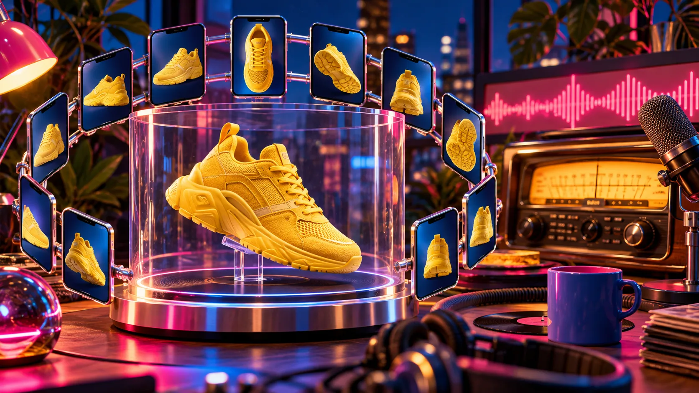

# Qué productos Shopify merecen un modelo 3D primero

No hace falta convertir todo el catálogo en 3D para comprobar si la idea aporta algo. El primer modelo debería ir a un producto cuya forma, escala o textura cambian de verdad cuando se ve desde varios ángulos, y que además puedas fotografiar de forma estable con el móvil. Esa combinación da un piloto mucho más útil que escoger el artículo más caro o el más popular sin más.

[Supra 3D Capture](https://supra-3d-capture.sktch.io/) convierte una serie guiada de fotos de teléfono en un archivo GLB para publicarlo como medio 3D de Shopify. Es una puerta de entrada práctica a la fotogrametría —reconstruir un objeto a partir de varias fotos—, pero conviene elegir el primer SKU con un criterio sencillo.

## La matriz de tres preguntas para priorizar

Puntúa cada candidato con 0, 1 o 2 en estas tres columnas. No pretende predecir ventas; sirve para elegir una prueba que enseñe algo claro.

| Pregunta | 0 puntos | 1 punto | 2 puntos |
| --- | --- | --- | --- |
| ¿Se entiende mejor al girarlo? | Una foto frontal basta | Tiene algún ángulo útil | Volumen, mecanismo o silueta importan |
| ¿El comprador necesita inspeccionarlo? | Compra por talla o reposición | Quiere ver un detalle | Necesita valorar acabados, proporciones o uso |
| ¿Puedes capturarlo con fotos consistentes? | Transparente, brillante o sin detalles | Requiere preparación | Mate, estable, con textura y buena luz |

Empieza por los que sumen 5 o 6. Una taza con asa, una lámpara pequeña, una zapatilla con textura o un objeto decorativo con relieve suelen explicar bien su forma al rotarlos. Una camiseta plana, una botella transparente o una joya muy reflectante pueden esperar. No son productos peores: simplemente son un primer experimento menos claro.

Esta regla evita una trampa común: elegir el SKU con más facturación y descubrir tarde que su superficie brillante, su tamaño o su logística complican cada toma. Si ya has preparado un producto para el catálogo con móvil, esta guía sobre [fotos 3D en Shopify](https://herramientas-y-tutoriales.github.io/2026/10/26/como-preparar-un-producto-para-fotos-3d-en-shopify-con-tu-movil/) es un buen complemento para dejar resuelta la mesa antes de abrir la cámara.

## Busca una diferencia que las fotos planas no resuelven

Un modelo 3D no sustituye las fotos de producto: responde a otra pregunta. La galería debe seguir mostrando color, contexto, medidas y detalle; el modelo deja que la persona explore el ángulo que le importa. Shopify documenta el uso de [media de producto y modelos 3D en los temas](https://shopify.dev/docs/storefronts/themes/product-merchandising/media), así que primero confirma que tu tema presenta ese medio donde esperas.

Para cada SKU candidato, mira su página actual y anota una frase: “con imágenes estáticas, un comprador todavía no ve ___”. Algunos buenos huecos son:

- cómo sobresale un asa, una tapa o una suela;
- la profundidad real de un producto compacto;
- el relieve, las uniones o una parte trasera relevante;
- cómo cambia el objeto al verlo de perfil.

Si no puedes completar esa frase, quizá una foto adicional o una tabla de medidas arregle el problema de forma más directa. Si sí puedes, el 3D tiene una función concreta en la página en vez de ser una decoración cara. El [auditoría de SKU antes de capturar 3D](https://the-lean-ecommerce.gitlab.io/2026/10/09/shopify-3d-capture-sku-audit/) ofrece otra forma de separar una buena hipótesis de una lista larguísima de productos.

## Haz una prueba de captura antes de prometerte una biblioteca 3D

Dedica una sesión corta a un solo objeto. Limpia el producto, usa luz uniforme y evita sombras que cambien entre fotos. Colócalo sobre una base estable y da una vuelta completa con el teléfono a una distancia parecida. No hace falta equipo de escaneo especializado para probar el flujo de [Supra 3D Capture en Shopify](https://apps.shopify.com/supra-3d-capture): su propuesta es una captura guiada desde móvil, procesamiento a GLB y publicación en Shopify.

La prueba tiene tres salidas posibles:

1. **El modelo se entiende y gira bien.** Es candidato para publicar y medir.
2. **El objeto es útil, pero la captura falla.** Repite con luz más difusa, un fondo menos confuso o un objeto de apoyo que luego puedas retirar.
3. **La superficie no coopera.** Los materiales transparentes, muy brillantes, peludos o sin rasgos pueden dar resultados ambiguos; cambia de SKU para el piloto.

La tercera salida no es un fracaso. Es información para decidir cuándo conviene una producción 3D distinta. Este tutorial sobre [capturar productos Shopify con el teléfono](https://how-to-blog.gitlab.io/2026/10/14/how-to-capture-shopify-products-for-3d-models-with-your-phone/) ayuda a convertir esa repetición en una rutina, no en una tarde de prueba y error.

## Publica el modelo donde responda una duda

Cuando el GLB esté listo, no lo escondas al final de una página llena de módulos. Ponlo junto a las fotos del producto si el tema usa el visor nativo, o usa el bloque de aplicación de Online Store 2.0 si quieres situarlo cerca de una explicación de materiales, de una comparación o de una llamada a la acción. La documentación de Shopify y la configuración del tema mandan: prueba en móvil y escritorio, y comprueba que no esté desplazando la información esencial.

Acompáñalo con una frase concreta, como “Gira el modelo para ver el cierre lateral” o “Mira el perfil para comprobar la profundidad”. Es más útil que “Explora en 3D”, porque conecta el gesto con la duda que querías resolver. Si necesitas publicar sin rehacer el tema, esta guía sobre [añadir media 3D a Shopify](https://tools-and-how-tos.github.io/2026/10/25/how-to-add-shopify-3d-product-media-without-rebuilding-your-theme/) explica el enfoque de integración.

## Mide el piloto sin inventar una victoria

Durante unas semanas, compara ese SKU consigo mismo: ¿la gente abre el visor?, ¿llega al carrito?, ¿qué preguntas siguen llegando al soporte? Anota también los costes reales de capturar, revisar y actualizar el modelo cuando cambia el producto. No atribuyas cualquier movimiento de conversión al 3D: cambian campañas, inventario, precio y tráfico. El objetivo inicial es comprobar si este tipo de media reduce una duda concreta y si tu equipo puede mantenerlo.

## El siguiente paso: un solo SKU, una hipótesis útil

El mejor primer modelo 3D no es necesariamente el más vendido. Es un producto con volumen o detalles que una persona necesita inspeccionar, una captura razonablemente fácil y una pregunta clara que el giro puede responder. Elige uno con la matriz, haz la prueba con el móvil y publica el modelo sólo cuando mejore una parte reconocible de la decisión de compra.

Si ese piloto funciona para tu proceso, instala [Supra 3D Capture](https://apps.shopify.com/supra-3d-capture) y convierte la siguiente captura en una decisión informada, no en un proyecto de catálogo completo.
