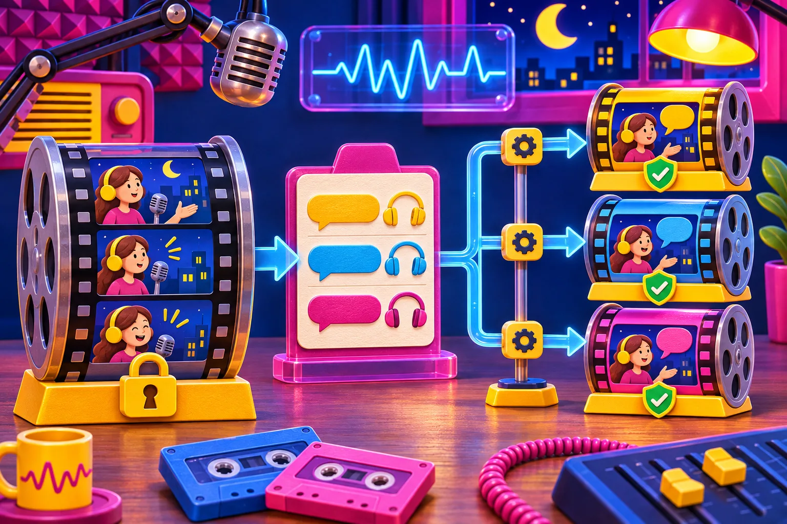

# Cómo Localizar Videos Programáticos sin Duplicar la Plantilla

Localizar un vídeo no debería significar copiar una línea de tiempo por cada idioma. La ruta más segura es conservar una sola plantilla visual, guardar el contenido variable en un objeto por idioma y generar un VideoJSON por variante. Así puedes corregir una escena o un precio una vez, previsualizar lo que verá cada audiencia y decidir si exportas en el navegador o en una cola de servidor.

[VideoFlow](https://videoflow.dev/core) encaja bien en este trabajo porque convierte una composición TypeScript en VideoJSON portable. Ese documento puede alimentar una vista previa, un editor o un render final sin obligarte a rehacer el proyecto para cada mercado. La idea no es traducir a ciegas: es separar lo que debe permanecer igual de lo que cada idioma necesita adaptar.



## Empieza con un contrato de localización

Antes de crear escenas, divide el vídeo en dos grupos. La plantilla fija contiene duración, orden de escenas, posiciones, animaciones, imágenes aprobadas, música y la llamada a la acción. El paquete localizable contiene título, subtítulo, locución, rótulos, URL de destino, moneda y, si hace falta, medios alternativos.

Este corte evita dos errores bastante caros: que una traducción cambie sin querer una animación aprobada, o que un cambio visual se quede olvidado en una de las copias. Tampoco asumas que cambiar texto basta. Un titular en alemán puede ocupar más espacio que su equivalente en español; una voz en otro idioma puede durar más; y una URL puede llevar a una página local distinta.

| Elemento | Vive en la plantilla | Vive en el paquete por idioma |
| --- | --- | --- |
| Orden, transiciones y ritmo base | Sí | No |
| Titular, subtítulo y CTA | No | Sí |
| Imagen de producto común | Sí | A veces |
| Locución y subtítulos | No | Sí |
| Precio, moneda y enlace final | No | Sí |

Un paquete pequeño y explícito es mejor que una colección de cadenas sueltas. Si tu sistema recibe datos de catálogo, esta separación se parece al flujo de [convertir datos de producto en vídeos editables y reutilizables](https://herramientas-y-tutoriales.github.io/2026/10/18/como-convertir-datos-de-producto-en-videos-editables-y-reutilizables/): los datos rellenan una estructura, no rediseñan el vídeo.

## Define límites antes de compilar el VideoJSON

Crea reglas que puedas comprobar automáticamente. Por ejemplo: máximo de caracteres por rótulo, duración máxima de locución, idiomas admitidos, fuentes disponibles y zonas seguras para subtítulos. Si una variante incumple una regla, debe volver a edición, no pasar al renderizador esperando que “se vea bien”.

Una forma sencilla de modelarlo es esta:

```ts
type LocaleVideo = {
  locale: "es-ES" | "en-US" | "pt-BR";
  headline: string;
  cta: string;
  landingUrl: string;
  voiceoverUrl: string;
};

function assertLocale(v: LocaleVideo) {
  if (v.headline.length > 44) throw new Error("Titular demasiado largo");
  if (!v.landingUrl.startsWith("https://")) throw new Error("URL no válida");
}
```

Después, tu función de composición usa esos valores solamente en las capas previstas. El [núcleo de VideoFlow](https://videoflow.dev/core) admite capas de texto, imagen, vídeo, audio, subtítulos y formas, y compila el resultado a VideoJSON. Para una primera versión, limita las variantes a texto, audio y destino; añade imágenes locales solo cuando haya una razón editorial o legal clara.

## Previsualiza la variante, no solo el JSON

Un JSON válido puede producir un vídeo incómodo: texto cortado, audio desfasado o una llamada a la acción que dura demasiado poco. Renderiza una vista previa de cada variante y usa una ficha breve de revisión: idioma correcto, longitud visual del titular, sincronía de voz y subtítulos, precio y destino correctos.


El renderizador DOM de VideoFlow monta un reproductor con reproducción y búsqueda por fotograma, útil para esa revisión dentro de tu aplicación. Si además quieres que un equipo no técnico ajuste una copia, el [editor React](https://videoflow.dev/react-video-editor) puede guardar una nueva versión del documento mediante sus callbacks. Guarda cada aprobación con el idioma y la versión de plantilla: no permitas que una corrección española sobrescriba una versión brasileña ya aprobada.

Este paso complementa, no sustituye, el control previo de un borrador creado por automatización. Si usas un agente o un generador, te servirá el enfoque de [revisar un vídeo creado con IA antes de exportarlo](https://herramientas-y-tutoriales.github.io/2026/10/22/como-revisar-un-video-creado-con-ia-antes-de-exportarlo/): la revisión mira el resultado para una audiencia concreta.

## Elige el renderizador según la entrega

El mismo VideoJSON puede viajar por tres rutas. Para una persona que pulsa “Exportar” en tu SaaS, el [renderizador de navegador](https://videoflow.dev/renderers) crea un MP4 en el cliente; así no tiene que subir el proyecto a tu servidor. Para cientos de variantes programadas, usa el renderizador de servidor desde Node en una cola. Para revisar o editar, usa el renderizador DOM.

No conviertas esta elección en una regla de prestigio técnico. Navegador funciona bien cuando el usuario ya está presente y el coste de infraestructura importa. Servidor es más apropiado para campañas nocturnas, entregas por API o reintentos controlados. En ambos casos conserva el VideoJSON aprobado como fuente de verdad y guarda el MP4 como resultado reproducible.

## Haz una prueba pequeña antes de multiplicar idiomas

Empieza con tres variantes que estresen cosas diferentes: un idioma corto, uno con frases largas y uno con una locución de ritmo distinto. No necesitas lanzar diez mercados para descubrir que tu caja de texto tiene un límite real. La prueba debe producir una lista de decisiones: qué campos admiten expansión, qué escena necesita más tiempo y qué mensajes deben reescribirse, no traducirse literalmente.


Tu control final puede ser corto:

1. ¿El VideoJSON proviene de la versión de plantilla aprobada?
2. ¿Todos los campos obligatorios del idioma están presentes y dentro de sus límites?
3. ¿Los subtítulos, la locución y la CTA coinciden con el destino local?
4. ¿La previsualización no corta texto ni tapa información clave?
5. ¿El MP4 final y su URL se han asociado a ese idioma y versión?

Para flujos con agentes, el hábito de guardar un documento estructurado antes de decidir dónde renderizar sigue siendo útil; aquí tienes una guía relacionada sobre [crear vídeos con JSON para que un agente los pueda revisar](https://herramientas-y-tutoriales.github.io/2026/10/10/como-crear-videos-con-json-para-que-un-agente-los-pueda-revisar/).

## Una plantilla, muchas versiones revisables

La localización sostenible no consiste en producir más archivos: consiste en mantener una fuente visual estable y hacer visibles las diferencias necesarias por mercado. VideoFlow te permite construir ese punto medio con TypeScript, VideoJSON y un renderizador que corresponde a tu entrega. Empieza con una sola plantilla, tres paquetes de idioma y una revisión real por variante; después automatiza lo que hayas podido comprobar.

Si estás integrando el flujo en una aplicación, explora los [renderizadores de VideoFlow](https://videoflow.dev/renderers) y monta primero una previsualización antes de poner el botón de exportación en producción.
