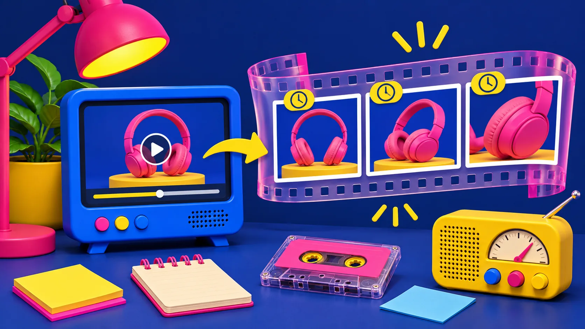
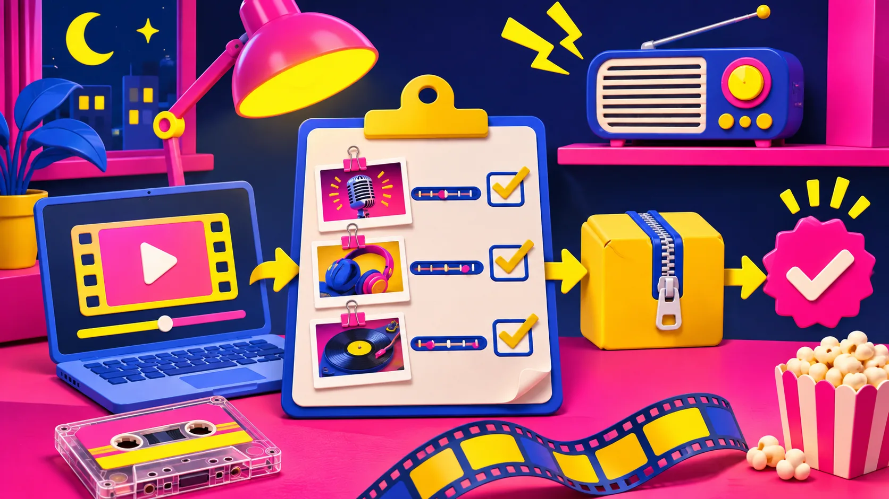

# Cómo extraer fotogramas de un video para una revisión con cliente

Cuando alguien comenta «el detalle se ve raro por aquí» en un video, responder con un minuto y medio de reproducción rara vez aclara nada. Conviene convertir el clip en unas pocas capturas PNG con su momento exacto. Así el cliente puede señalar un producto, una transición o un texto sin adivinar dónde ocurre. Con [Video Frame Extractor](https://tiny-online.tools/video-tools/video-frame-extractor) puedes extraer imágenes a intervalos desde el navegador; después solo hay que elegir las que realmente prueban algo.

Esto no sustituye una revisión completa del video ni corrige un render defectuoso. Es una forma pequeña y muy práctica de hacer que la conversación sea específica, especialmente si el clip contiene demostraciones de producto, pantallas o antes y después.

## Empieza por una pregunta, no por exportar todo

La trampa habitual es descargar cientos de imágenes y crear una carpeta que nadie abrirá. Antes de cargar el video, escribe una pregunta de revisión: «¿se lee la etiqueta al segundo 12?», «¿aparece el color correcto?», «¿el cambio de plano corta demasiado pronto?». Esa pregunta decide el intervalo.

| Si quieres comprobar… | Intervalo razonable | Qué entregar |
| --- | --- | --- |
| Un detalle que cambia despacio | 3 a 5 segundos | 3–6 capturas |
| Un paso de una demo | 1 segundo | Secuencia corta y ordenada |
| Un corte o movimiento rápido | 0,5 segundos | Ventana de 4–8 capturas |
| La portada de un clip | Una captura concreta | Una opción principal y una alternativa |

La herramienta acepta archivos de video que el navegador pueda reproducir y guarda los fotogramas como PNG. También permite definir el intervalo y un máximo de imágenes, una combinación útil para no crear una extracción absurda. Si solo necesitas la miniatura de un momento concreto, el [Video Poster Frame Picker](https://tiny-online.tools/video-tools/video-poster-frame-picker) es una ruta más directa.

## Un flujo de cuatro pasos que sí termina

1. **Trabaja sobre una copia corta.** Para una revisión puntual, recorta primero el tramo que interesa. No hace falta entregar un archivo de diez minutos para discutir dos segundos.
2. **Extrae con un intervalo provisional.** En una demo de 30 segundos, empezar cada dos o tres segundos suele revelar el contexto. Baja a medio segundo solo alrededor de un gesto, un cambio de pantalla o una transición que genere dudas.
3. **Nombra la evidencia con el tiempo y la decisión.** En vez de `frame-04.png`, usa algo como `00-12-etiqueta-legible.png`. El nombre no tiene que ser bonito; debe permitir que otra persona vuelva al punto correcto.
4. **Envía un paquete deliberadamente pequeño.** Un video, de tres a ocho capturas y una línea por captura: qué mirar, qué decisión espera y qué pasa si hay que cambiarlo.

## Cómo elegir los fotogramas que ayudan de verdad

Yo usaría tres filtros. El primero es **legibilidad**: ¿la persona puede ver el detalle sin ampliar ni reproducir el clip? El segundo es **contexto**: una captura aislada de un botón quizá no explica en qué pantalla vive. El tercero es **decisión**: cada imagen debe responder aprobar, corregir o comparar; no solo ser una imagen bonita.

Si estás revisando imágenes de un producto dentro del video, combina esta selección con la [revisión de foto antes de publicarla en Shopify](https://herramientas-y-tutoriales.github.io/2026/11/04/como-revisar-una-foto-de-producto-antes-de-publicarla-en-shopify/): bordes, fidelidad, encuadre y archivo editable siguen importando aunque la imagen aparezca por menos de un segundo. Para una foto destinada a una ficha o marketplace, también puede servir esta guía para [prepararla sin instalar programas](https://herramientas-y-tutoriales.github.io/2026/10/25/como-preparar-una-foto-de-producto-para-un-marketplace-sin-instalar-pr/).

No confundas una captura con una prueba suficiente. Si la duda es «¿suena bien?», necesitas escuchar. Si es «¿el enlace funciona?», hay que tocarlo. Las capturas fijan la evidencia visual, no reemplazan las pruebas funcionales.

## La tarjeta de entrega que evita comentarios vagos

Junto al enlace del video, pega esta tarjeta breve:

- **Objetivo:** qué se está aprobando hoy.
- **Rango:** desde qué segundo hasta qué segundo mirar.
- **Capturas:** tres a ocho PNG con nombres por tiempo.
- **Pregunta:** una decisión concreta, por ejemplo «¿aprobamos esta portada?».
- **Límite:** qué no demuestra el paquete (audio, enlaces, velocidad real o comportamiento móvil).

Esta estructura es útil antes de una aprobación de primer corte. Si el video se generó con IA, vale la pena sumar la lista de [qué revisar en el primer corte antes de exportarlo](https://herramientas-y-tutoriales.github.io/2026/10/31/que-revisar-en-el-primer-corte-de-un-video-de-lanzamiento-generado-con/), donde el mensaje y la fidelidad del producto pesan más que un efecto llamativo.

## Cuándo no usar este método

No extraigas una secuencia completa para ocultar una mala versión. Si el cliente necesita sentir el ritmo, recibe el video. Si necesita anotar cambios de escena, manda un enlace con reproducción y usa las capturas como índice. Si el archivo es sensible, confirma primero que el flujo elegido encaja con tu política: Tiny Online Tools indica que el procesamiento ocurre en el navegador y que los archivos no se suben, pero eso no elimina las reglas internas de tu equipo.

Tampoco conviertas cada comentario en una nueva tanda. Reúne las decisiones, aplica una ronda de cambios y crea otro paquete solo para los puntos modificados. Es más claro que perseguir veinte archivos sueltos por chat.

## Convierte el clip en una conversación concreta

Para la próxima revisión, abre [Video Frame Extractor](https://tiny-online.tools/video-tools/video-frame-extractor), elige un intervalo que responda a una sola pregunta y entrega solo las capturas que sostienen una decisión. En cinco minutos puedes pasar de «por ahí se ve raro» a un comentario que alguien puede corregir sin interpretar mensajes crípticos.
