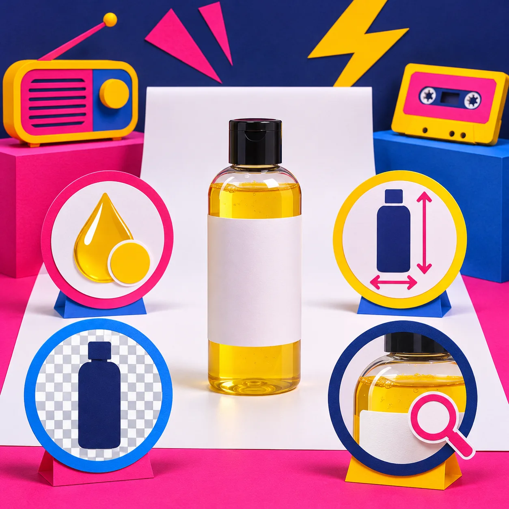

# Cómo revisar una foto de producto antes de publicarla en Shopify

Una foto de producto no está lista cuando parece bonita en el editor: está lista cuando sigue describiendo el producto real al verla en una ficha, en móvil y junto a las demás imágenes. Antes de subirla a Shopify, haz una revisión de cuatro minutos: bordes, color, tamaño y contexto. Para los retoques pequeños, [ImageFlow](https://imageflow.dev/) permite trabajar en el navegador con capas, máscaras, ajustes y exportación PSD; aun así, el control final sigue siendo humano.

La idea no es convertir cada foto en una producción interminable. Es detectar el tipo de fallo que solo aparece después: un halo claro alrededor del objeto, una etiqueta borrada por accidente, una botella que se ve demasiado azul o una imagen que tarda tanto en cargar que el detalle útil llega tarde.

## La regla: corrige la foto, no el producto

Un ajuste de exposición, una máscara limpia o la eliminación de una mota de polvo pueden ayudar a que el artículo se entienda. Cambiar su color, afinar su forma, ocultar una costura, añadir un accesorio que no viene incluido o exagerar el tamaño no. Esta separación evita discusiones con clientes y también hace que el catálogo sea más consistente.

Si partes de una imagen complicada, trabaja con una copia editable. ImageFlow anuncia capas, máscaras, modos de fusión, capas de ajuste, objetos inteligentes y herramientas de texto y filtros en el navegador; eso es útil precisamente porque permite revisar o deshacer una decisión en vez de pintar sobre el original. Para un recorte, empieza con selección y máscara, no con el borrador: así podrás corregir un pelo, una sombra o una esquina después.

## La revisión de cuatro señales

| Señal | Qué mirar | Cuándo no publicar todavía |
| --- | --- | --- |
| Borde | Zoom al 100 % alrededor del objeto | Halo, dientes de sierra, sombra cortada o fondo que invade el producto |
| Fidelidad | Color, textura, etiqueta y piezas incluidas | La edición cambia material, tono o contenido de la caja |
| Encaje | Recorte y tamaño en móvil y en la cuadrícula | El producto queda diminuto, cortado o inconsistente con el resto |
| Archivo | Formato, nombre y versión editable | Solo existe una exportación plana o no sabes cuál es la versión final |

Esta tabla funciona mejor que una pregunta vaga como “¿se ve bien?”. Da a quien revisa una tarea concreta y da a quien edita un motivo claro para volver al archivo.

## 1. Revisa el borde antes de cambiar el fondo

Cuando quitas un fondo, el error más común no es que falle la selección completa: es que falle donde más importa. Acércate a los contornos que explican el objeto: asas, tapones, cables, pelo, transparencias, letras del envase y sombras de apoyo. Comprueba también el borde contra un fondo claro y uno oscuro; un recorte puede verse correcto en blanco y revelar un halo gris sobre un color intenso.

La regla práctica es sencilla: conserva una sombra realista si ayuda a leer la forma, pero no inventes una sombra que parezca pertenecer a otra iluminación. Si el borde sigue dudoso, vuelve a la máscara y ajusta solo esa zona. No hace falta reconstruir toda la foto.

## 2. Comprueba el color con una referencia, no con la memoria

Las pantallas y la luz de edición engañan. Pon junto a la foto una muestra física, una imagen aprobada o una carta de color de tu equipo. No buscas una coincidencia científica imposible entre pantallas; buscas evitar que un beige se publique como gris, que un metal pierda su acabado o que una prenda parezca de otro tono.

Aquí conviene ser conservador con los ajustes locales y con el relighting. Aclarar una escena para que se vea el producto puede ser útil; usar luz o relleno para cambiar el color percibido del producto no lo es. Si una variación real de color necesita explicación, resuélvela con una imagen adicional, texto de variante o ambos, no con una edición que prometa algo distinto.

## 3. Haz una prueba de encaje antes de exportar

No decidas el recorte solo mirando un lienzo grande. Shopify admite imágenes, vídeos y modelos 3D como media de producto; su documentación para temas explica que esa media suele mostrarse en la página del producto y puede reutilizarse en otras zonas. Por eso conviene mirar la exportación en el contexto en que se verá: la ficha, la cuadrícula de colección y un teléfono.

Haz esta prueba rápida:

1. Duplica la foto editada y coloca una versión junto a dos imágenes reales de tu catálogo.
2. Mira las tres a tamaño pequeño: ¿se reconoce el producto y se mantiene el mismo aire visual?
3. Abre una previsualización móvil: ¿la parte importante sigue dentro del recorte?
4. Vuelve al tamaño grande y verifica rótulos, costuras y bordes.

Si tu catálogo necesita varias vistas, usa una imagen principal clara y deja las fotos de detalle para responder preguntas concretas. Esta lógica se parece a la de [preparar una foto para un marketplace sin instalar programas](https://herramientas-y-tutoriales.github.io/2026/10/25/como-preparar-una-foto-de-producto-para-un-marketplace-sin-instalar-pr/): cada imagen debería ganar su lugar porque aclara algo, no porque llena espacio.

## 4. Guarda la salida y el archivo de trabajo con nombres distintos

Un error silencioso es exportar una buena imagen y luego perder la manera de repetirla. Conserva un archivo editable con capas o máscaras y una exportación final separada. Un nombre tan simple como `vela-ambar-principal-v03.psd` y `vela-ambar-shopify-2000px-v03.jpg` ya evita que el equipo vuelva a retocar la salida equivocada.

Si recibes un PSD de otra persona, ImageFlow puede importar y exportar PSD y PSB según su sitio; úsalo para cambios delimitados y comprueba tu propio archivo complejo antes de convertirlo en un flujo de producción. Las fuentes, objetos inteligentes, modos de color y efectos son justo el tipo de detalles que merecen una prueba con un archivo real.

## Una tarjeta de aprobación que cabe en un comentario

Antes de marcar una imagen como lista, deja este registro junto al archivo:

- **Producto y variante:** ¿la foto corresponde exactamente a lo que se vende?
- **Cambios aplicados:** por ejemplo, “fondo limpio, exposición +0,2; sin cambio de color”.
- **Bordes revisados:** claro / oscuro / zoom.
- **Contexto revisado:** ficha, colección y móvil.
- **Archivo editable:** ubicación y versión.

Es una pequeña barrera contra los cambios accidentales y una ayuda enorme cuando una persona distinta prepara la próxima campaña. Si el volumen de imágenes crece, también te puede servir el criterio de [auditar una edición masiva de Shopify antes de aplicarla a todo el catálogo](https://herramientas-y-tutoriales.github.io/2026/10/14/como-auditar-una-edicion-masiva-de-shopify-antes-de-aplicarla-a-todo-e/): prueba primero con una muestra representativa y corrige la regla, no cien archivos uno por uno.

## Cuándo parar y pedir otra foto

La edición no sustituye una imagen base suficiente. Para y solicita una nueva toma si no puedes distinguir el material, si falta una vista necesaria, si el producto está desenfocado, si la iluminación borra una diferencia de variante o si la única manera de “arreglarlo” sería cambiar algo real. En esos casos, una nueva fotografía es más honesta y normalmente más rápida que una hora de retoque.

Esto también aplica cuando quieres mostrar una forma compleja. Antes de decidir que una foto debe hacer todo el trabajo, revisa [qué productos merecen un modelo 3D primero](https://herramientas-y-tutoriales.github.io/2026/11/02/que-productos-shopify-merecen-un-modelo-3d-primero/). Una imagen limpia y una vista complementaria suelen comunicar mejor que una transformación agresiva.

## Publica con menos dudas

Abre una imagen real en ImageFlow y haz la mejora más pequeña que ayude: una máscara mejor, una capa de ajuste o un objeto distraído eliminado con cuidado. Después pasa las cuatro señales. La revisión tarda poco, protege la fidelidad del producto y deja un proceso que tu equipo puede repetir.

Para seguir afinando el catálogo, mira también [cómo explicar dónde medirse antes de elegir una talla](https://herramientas-y-tutoriales.github.io/2026/10/24/como-explicar-donde-medirse-antes-de-elegir-una-talla-en-shopify/) y [cómo elegir qué información va en acordeones de Shopify](https://herramientas-y-tutoriales.github.io/2026/10/19/como-elegir-que-informacion-va-en-acordeones-de-shopify/): una ficha más útil no depende solo de la foto, sino de que cada elemento responda una duda real.

Fuentes: [ImageFlow](https://imageflow.dev/) y [documentación de media de producto de Shopify](https://shopify.dev/docs/storefronts/themes/product-merchandising/media/support-media).
