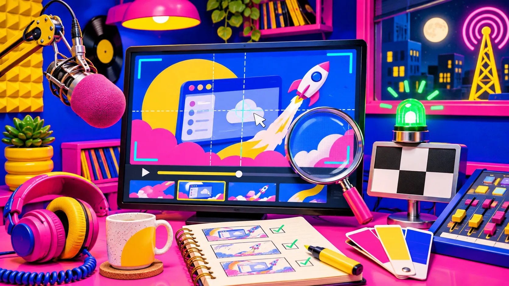

# Cómo convertir una web SaaS en un guion de video de lanzamiento

Un video de lanzamiento no tiene que repetir toda tu web a velocidad doble. La salida más clara es elegir una promesa concreta, convertirla en una secuencia de tres a cinco escenas y revisar el primer render como si fuera una página de venta. Si partes de una URL, [VideoFlow Studio](https://studio.videoflow.dev/) puede investigar el producto, proponer el plan y generar un film de motion graphics que sigue siendo editable; el criterio creativo sigue siendo tuyo.

El error más común es pedir «un video de mi producto» y esperar que la herramienta adivine qué importa. Una web tiene navegación, precios, integraciones y matices. Un buen trailer tiene una sola idea que avanza. Esta guía sirve para convertir lo primero en lo segundo sin escribir un guion cinematográfico.

## Empieza por la frase que el video debe dejar

Antes de pensar en pantallas, completa esta frase: «Para **[tipo de persona]**, nuestro producto hace posible **[resultado]** sin **[fricción habitual]**». No es un eslogan definitivo. Es el filtro para decidir qué entra en 30 o 45 segundos.

Por ejemplo, una herramienta de soporte no necesita mostrar su panel entero. Podría dejar esta idea: «Un equipo pequeño responde lo urgente sin perder el contexto». Entonces la historia no va sobre ocho pestañas: va de una consulta dispersa a una respuesta ubicada.

Haz una lista de todo lo que te tienta mostrar y clasifícalo así:

| Elemento de la web | ¿Entra en el primer video? | Razón |
| --- | --- | --- |
| Problema reconocible | Sí | Hace que el espectador se identifique rápido. |
| Mecanismo principal | Sí | Demuestra cómo cambia el problema. |
| Resultado visible | Sí | Da cierre a la promesa. |
| Integraciones, precios y cada ajuste | Normalmente no | Son buenas pruebas para una página o una demo. |
| Un detalle que contradice la promesa | No | Abre otra historia y diluye el ritmo. |

Esta selección también ayuda a preparar el material de origen. Si la demo depende de una interfaz, procura que los datos de prueba sean legibles y honestos. La misma regla de fidelidad aplica cuando [revisas una foto de producto antes de publicarla en Shopify](https://herramientas-y-tutoriales.github.io/2026/11/04/como-revisar-una-foto-de-producto-antes-de-publicarla-en-shopify/): lo bonito no debe prometer algo que el producto no hace.

## Convierte la promesa en una columna vertebral de cuatro escenas

Un esquema sencillo evita el catálogo de funciones. Usa esta progresión:

1. **Tensión:** una situación cotidiana que el público reconoce.
2. **Giro:** aparece el producto y su mecanismo clave.
3. **Prueba:** una acción o cambio de estado visible, no una lista de beneficios.
4. **Llegada:** el resultado y una llamada a la acción coherente.

Escribe una línea por escena y asigna a cada una un único objeto visual: una tarjeta, una consulta, un calendario, un gráfico o una pantalla. Repetir ese objeto, transformado, da continuidad. Si cada escena estrena metáfora, color y función, el espectador tiene que recomenzar la lectura.

[VideoFlow Studio](https://studio.videoflow.dev/) está pensado justo para este trabajo: toma la URL, estudia producto, público, marca y características, y construye un plan antes de renderizar. Su sitio describe una secuencia de web, comprensión, dirección, diseño y render con revisión del resultado codificado. Úsalo como punto de partida, pero lee el plan: debe contener tu frase central y no cinco frases competidoras.

## Pon una pregunta a cada escena

Una escena útil responde una pregunta. Si no puedes formularla, probablemente solo está decorando. Este es un control rápido:

| Escena | Pregunta que responde | Señal de que sobra |
| --- | --- | --- |
| Tensión | «¿Esto me pasa a mí?» | Podría pertenecer a cualquier empresa. |
| Giro | «¿Qué hace distinto este producto?» | Solo enseña un logo o una transición. |
| Prueba | «¿Cómo sé que funciona?» | Enumera funciones sin consecuencia. |
| Llegada | «¿Qué hago ahora?» | Pide comprar sin conectar con el resultado. |

Mantén cada respuesta en una sola frase antes de animarla. No hace falta meter toda la copia de la web dentro del video. Para revisar una toma concreta, puedes apoyarte en este método de [extraer fotogramas de un video para una revisión con cliente](https://herramientas-y-tutoriales.github.io/2026/11/04/como-extraer-fotogramas-de-un-video-para-una-revision-con-cliente/): un fotograma revela textos pequeños, márgenes y elementos que compiten por atención.

## Da instrucciones de revisión que una persona pueda comprobar

«Hazlo más dinámico» es una petición válida, pero difícil de evaluar. Después del primer corte, convierte tus comentarios en decisiones observables:

- «Mantén el resultado final dos segundos más.»
- «Quita la integración que no aparece en la promesa.»
- «Haz que el objeto amarillo conecte la escena uno y la tres.»
- «Sube el contraste del botón y reduce el texto secundario.»

Studio permite dirigir cambios en lenguaje natural desde el terminal o el navegador y conservar el proyecto editable en su editor. También afirma que revisa el render final —no solo el código— para detectar cuestiones visuales antes de volver a renderizar. Eso no reemplaza tu revisión de marca: comprueba nombres, datos, idioma, ritmo y cualquier afirmación comercial.

## Haz una prueba de tres espectadores antes de exportar

No necesitas un estudio de mercado para detectar una primera versión confusa. Muestra el corte a tres personas que no hayan discutido el guion contigo y pregunta solo esto:

1. ¿Qué problema crees que resuelve?
2. ¿Qué parte recuerdas una hora después?
3. ¿Qué harías después de ver el final?

Si las respuestas no coinciden con tu frase inicial, no agregues otra función. Ajusta la escena que dejó la pregunta abierta. Para equipos que necesitan adaptar una misma pieza a más de un mercado, primero fija esta columna vertebral y después consulta cómo [localizar videos programáticos sin duplicar la plantilla](https://herramientas-y-tutoriales.github.io/2026/11/03/como-localizar-videos-programaticos-sin-duplicar-la-plantilla/). Traducir un guion disperso solo multiplica el problema.

## Cuándo este método no es suficiente

Un video de lanzamiento corto no sustituye una demo, tutorial de producto ni pieza de marca emocional. Si vendes a un comité técnico, quizá necesites después una demostración larga; si el comprador necesita comparar planes, esa información merece una página clara. El objetivo aquí es conseguir una primera atención precisa, no cerrar todos los argumentos.

Tampoco confundas VideoFlow Studio con el motor abierto VideoFlow. Studio es el flujo para pasar de una URL a un video planificado, renderizado y editable. El [repositorio de VideoFlow](https://github.com/ybouane/VideoFlow) describe el motor de video programático que compila a un formato JSON portable y puede renderizar en distintos entornos. Para quien quiere escribir una aplicación de video en TypeScript, ese nivel puede ser el adecuado; para quien necesita un primer trailer desde una web, Studio reduce el trabajo de orquestación.

La próxima vez que prepares un lanzamiento, no empieces seleccionando transiciones. Escribe la frase que quieres que sobreviva al video, dibuja cuatro respuestas y genera un primer corte. Después pruébalo con espectadores reales y pide correcciones concretas. Si quieres convertir esa URL y ese breve plan en una pieza que puedas seguir editando, abre [VideoFlow Studio](https://studio.videoflow.dev/) y comienza por el sitio, no por una plantilla.

Un último apunte: cuando reutilices el resultado para redes, conserva la misma idea central; esta guía para [convertir un patrón de soporte en un post útil para X](https://herramientas-y-tutoriales.github.io/2026/11/07/como-convertir-un-patron-de-soporte-en-un-post-util-para-x/) es un buen recordatorio de que cada formato necesita su propia forma, no una copia literal.
