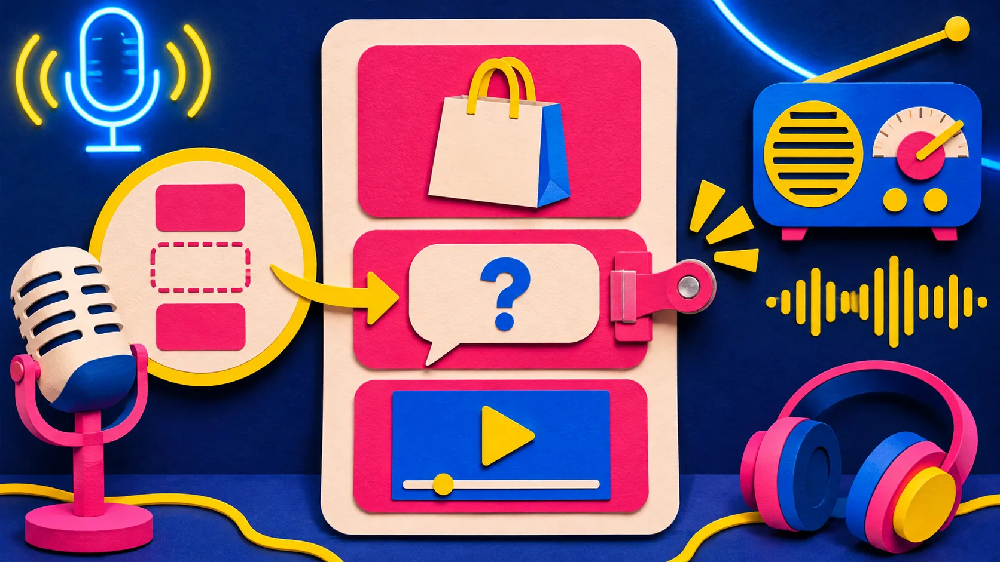

# Dónde colocar un vídeo UGC en una página de producto Shopify

Un vídeo UGC no tiene que vivir arriba de todo ni funcionar como un anuncio largo. En una página de producto Shopify, suele rendir mejor justo después de la duda que ayuda a resolver: tamaño real, uso, textura, montaje o qué incluye el pedido. Así el vídeo convierte una pregunta concreta en una pequeña demostración y deja que el botón de compra haga su trabajo.

La clave es tratarlo como una respuesta visual, no como decoración. [Supra UGC Maker](https://apps.shopify.com/supra-ugc-maker) permite partir de una imagen de producto, elegir modelo y escena, redactar el guion y ajustar o regenerar segmentos dentro del mismo proyecto. Eso facilita probar una pieza breve antes de reorganizar toda la ficha.

## Empieza por la pregunta que detiene la compra

Antes de abrir el generador, revisa los mensajes de soporte, reseñas y conversaciones de ventas. No busques una frase brillante; busca una incertidumbre que se repita. Para una crema podría ser «¿cómo se siente sobre la piel?». Para una lámpara, «¿cuánta luz da de verdad?». Para un organizador, «¿cabe en mi cajón?».

El vídeo no debe prometer algo que no puedas demostrar. Si el cliente necesita medidas, añade primero una tabla o una imagen de escala. Si necesita instrucciones, muestra el paso decisivo. Y si la duda es sobre variantes, recuerda que Shopify indica que los vídeos y modelos 3D no se pueden asignar al contenido multimedia de variantes; conviene explicar la diferencia en la propia página en vez de confiar en el vídeo para desambiguarla. [La documentación de Shopify sobre multimedia de producto](https://help.shopify.com/en/manual/products/product-media/add-media) también confirma que el primer elemento de la galería es el medio destacado en colecciones, carrito, checkout e inicio: una razón más para no sustituir la imagen principal por un vídeo que sólo responde a una duda secundaria.

## Elige la ubicación con una regla sencilla

| Si el cliente se pregunta… | Coloca el vídeo… | El primer plano debe mostrar… |
| --- | --- | --- |
| «¿Qué es?» | Tras el resumen inicial | producto, tamaño y uso en una frase |
| «¿Me sirve a mí?» | Después de beneficios o casos de uso | situación concreta y límite honesto |
| «¿Cómo se usa?» | Junto a instrucciones | el gesto clave, no toda la rutina |
| «¿Qué recibo?» | Antes de envío o devoluciones | contenido del paquete y escala |

Esta regla evita el carrusel de vídeos sin función. Para comparar alternativas de presentación, la guía sobre [cómo decidir entre vídeo de lanzamiento en terminal o navegador](https://herramientas-y-tutoriales.github.io/2026/11/08/como-elegir-entre-crear-tu-video-de-lanzamiento-en-terminal-o-navegado/) ofrece una idea útil: empieza por el flujo que el equipo realmente pueda mantener. Aquí significa que un vídeo de 12–20 segundos, revisable y fácil de actualizar, es mejor que una gran producción que se queda vieja al cambiar una variante o una promoción.

## Escribe un guion de tres planos, no un monólogo

Un buen vídeo de ficha puede seguir esta secuencia:

1. **Duda:** nombra el momento del comprador: «Si buscas una textura ligera…».
2. **Prueba visual:** enseña el producto en el contexto que valida la frase.
3. **Siguiente paso:** indica qué mirar o qué elegir: «consulta los ingredientes» o «elige tu tamaño».

En Supra UGC Maker puedes combinar avatar, escena, producto, voz y tono; la ficha de la aplicación también indica que permite previsualizar la escena, recortar, reordenar y actualizar clips sin reconstruir el proyecto. Úsalo para cambiar una sola variable por vez. Por ejemplo: conserva la demostración y prueba dos aperturas, no cinco mensajes y tres fondos a la vez. Si tu objetivo es un vídeo más amplio de lanzamiento, esta guía sobre [convertir una web SaaS en un guion de vídeo](https://herramientas-y-tutoriales.github.io/2026/11/08/como-convertir-una-web-saas-en-un-guion-de-video-de-lanzamiento/) separa muy bien la evidencia de la página de las frases de guion.

## Haz una prueba antes de mover toda la ficha

No necesitas cambiar la galería completa para aprender algo. Crea una versión para un producto con tráfico razonable y observa durante una semana: reproducciones, clics hacia la compra, preguntas de soporte y devoluciones relacionadas con la duda elegida. No atribuyas una mejora de conversión al vídeo si al mismo tiempo cambiaste precio, fotos o envío.

Para esta primera prueba, apunta en una hoja: producto, duda, ubicación, primera frase, duración y resultado. Esa pequeña ficha es más útil que guardar «vídeo azul final final». Si debes revisar el material antes de publicarlo, la lista de [qué revisar en el primer corte de un vídeo generado con IA](https://herramientas-y-tutoriales.github.io/2026/10/31/que-revisar-en-el-primer-corte-de-un-video-de-lanzamiento-generado-con/) ayuda a detectar cuando el mensaje se perdió entre efectos. Y si la duda no se resuelve mejor con vídeo, no lo fuerces: una buena foto de producto también merece una revisión propia antes de salir a Shopify.

## Pasa esta lista de cuatro puntos antes de publicar

- **Producto:** ¿el envase, color, accesorio y cantidad coinciden con la ficha actual?
- **Promesa:** ¿el guion describe lo que se ve, sin convertir una posibilidad en garantía?
- **Ubicación:** ¿aparece después de la pregunta que responde, no antes de que exista contexto?
- **Salida:** ¿la última frase guía a una ficha, variante, medida o política real?

## Cuándo usar creadoras reales en lugar de un avatar

Un avatar con IA es especialmente práctico para explicar producto, preparar variaciones y actualizar un mensaje cuando cambia la campaña. No sustituye el testimonio de una clienta ni la confianza de una creadora que usa el producto y habla desde su propia experiencia. Para reseñas, comunidad o demostraciones donde la credibilidad depende de una vivencia personal, pide permiso, usa contenido real y deja claro el contexto.

Para una prueba controlada de una respuesta visual, instala [Supra UGC Maker](https://apps.shopify.com/supra-ugc-maker), elige una sola duda y crea dos versiones cortas del mismo plano central. Su plan gratuito publica actualmente hasta tres segmentos de vídeo al mes, una escala razonable para validar la ubicación antes de producir una biblioteca entera.

Un vídeo UGC útil no llena espacio: despeja una decisión. Ponlo donde aparece la pregunta, muestra una prueba concreta y mantenlo fácil de revisar cuando la ficha cambie.
