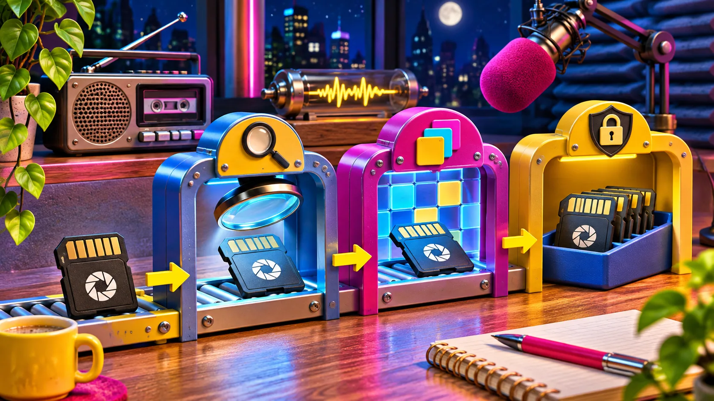

Cuando un proveedor envía fotos RAW, el error no es aceptarlas: es tratarlas como si todas fueran iguales. El filtro de entrada útil comprueba el archivo y su variante antes de iniciar una vista previa o una conversión, deja claros los límites y conserva una salida alternativa. Así evitas que una subida aparentemente válida termine en una pantalla rota, una espera interminable o una promesa de compatibilidad que tu producto no puede cumplir.

[FlashRaw](https://flashraw.ybouane.com/) es una opción práctica para construir ese filtro en herramientas de fotografía: descodifica formatos RAW de cámara en Rust y también ofrece rutas para JavaScript/WebAssembly, Python y C/C++. Pero el nombre del archivo no basta. Su propia [matriz de formatos](https://github.com/ybouane/flashraw/blob/main/docs/formats.md) documenta la compatibilidad por formato y modo —profundidad, compresión y recorte—, que es exactamente la forma correcta de plantear una subida.

## La regla sencilla: detectar primero, procesar después

RAW no es un formato único; es una familia de contenedores y compresiones. Un `.NEF` puede venir de cámaras y modos distintos. Un `.DNG` puede tener características que cambian qué decodificador o compilación necesitas. Por eso el primer paso no debería ser “convertir a JPEG”, sino responder tres preguntas pequeñas:

1. ¿El archivo parece ser del tipo que tu producto espera?
2. ¿Esta cámara y esta variante entran en la ruta que has probado?
3. ¿Qué experiencia ofreces si no entran?

Esa tercera pregunta suele salvar la relación con quien sube el archivo. “No podemos abrir este modo todavía; conserva el original y sube una vista previa JPEG” es una respuesta mucho más honesta que dejar que el progreso llegue al 99 %. La documentación de FlashRaw, por ejemplo, distingue `verified`, `partial`, `experimental` y `unsupported`; úsalo como modelo de lenguaje de producto, no como una afirmación automática sobre todos los archivos de una extensión.

| Resultado del filtro | Qué haces | Qué no prometes |
| --- | --- | --- |
| Variante comprobada | Ofreces extracción de vista previa o descodificación | Que el render final coincidirá con cualquier editor de escritorio |
| Variante parcial o experimental | Pides confirmación o la envías a revisión | Que el flujo será idéntico para todos los archivos |
| Variante no reconocida | Conservas el original y propones JPEG/TIFF o soporte | Que “RAW está soportado” solo por la extensión |

Esta separación también aclara la interfaz: una vista previa incrustada puede ser suficiente para escoger imágenes, mientras que una descodificación completa tiene otro coste de memoria y tiempo. La guía [How to Validate Browser Camera RAW Uploads Before Building a Previewer](https://how-to.the-lean-ecommerce.com/2026/10/27/how-to-validate-browser-camera-raw-uploads-before-building-a-previewer/) desarrolla esa frontera antes de construir la parte visual.

## Un filtro de entrada en cuatro pasos

### 1. Guarda el original y limita el trabajo temprano

No uses el primer archivo recibido como material desechable. Conserva el blob original o una referencia de almacenamiento antes de hacer conversiones. Después aplica límites razonables: tamaño máximo, tiempo de trabajo y número de tareas simultáneas. Un archivo de cámara grande no es necesariamente malo; solo necesita una ruta que no bloquee el resto de la aplicación.

También conviene leer sólo lo imprescindible al principio: cabecera, metadatos disponibles y una previsualización incrustada cuando exista. Esto te permite decidir sin pagar siempre el coste de procesar la imagen completa. FlashRaw documenta extracción de vistas previas y descodificación por región o mosaico; son capacidades que hay que evaluar en tu combinación de archivo y destino, no botones mágicos para cada cámara.

### 2. Convierte la compatibilidad en una lista de archivos reales

Un texto de ayuda no sustituye a una colección de pruebas. Crea un pequeño lote con los archivos que recibes de verdad: una cámara frecuente, una variante comprimida, un archivo grande y un caso que esperas rechazar. Para cada uno anota modelo, extensión, modo de compresión, resultado esperado y ruta elegida.

No necesitas publicar una tabla de rendimiento espectacular. Sí necesitas saber que el archivo que usa tu proveedor más importante produce el estado correcto. El [checklist de carga RAW para navegador](https://the-lean-ecommerce.gitlab.io/2026/10/30/a-browser-raw-upload-checklist-i-use-before-shipping-a-previewer/) es una buena referencia para convertir ese lote en una comprobación de lanzamiento.

### 3. Elige una ruta, no una promesa genérica

Una aplicación de catálogo puede necesitar únicamente una miniatura para que el equipo identifique la toma. Una herramienta de edición puede requerir datos de sensor, balance de blancos, matriz de color y una salida RGB. Son trabajos distintos. La web oficial de FlashRaw explica que puede extraer vistas previas, abrir el archivo en el navegador y producir una imagen para pantalla, pero eso no elimina tu decisión de producto: ¿qué resultado necesita el lector de esta pantalla?

Esta es una forma sencilla de decidir:

- Si la persona sólo debe identificar una imagen, intenta primero la vista previa incrustada.
- Si debe revisar el encuadre con más detalle, prueba la ruta de descodificación que has validado para esa variante.
- Si debe editar color o exportar una entrega final, define la salida, el perfil de color y la comparación que aceptarás antes de anunciar equivalencia.

Para lanzamientos de carga de fotos, añade este criterio a un [fixture gate con archivos de cámara](https://the-lean-ecommerce.github.io/2026/11/05/a-camera-raw-fixture-gate-for-shopify-upload-releases/): cada cambio de dependencia debe pasar el mismo lote y producir la misma decisión de ruta.

### 4. Diseña una alternativa que no castigue al proveedor

Rechazar un modo concreto no debe significar perder la entrega. Muestra qué has detectado, conserva el original si tu política lo permite y pide una alternativa útil: JPEG de alta calidad para selección, TIFF para una ruta de posproducción acordada o un RAW de una variante que tu equipo haya confirmado.

La alternativa también evita convertir al soporte en detectives de extensiones. Pide el modelo de cámara y una muestra autorizada sólo cuando el filtro no pueda clasificar el archivo. Así la conversación aporta evidencia para ampliar la matriz, no una colección de capturas borrosas.

## El recibo de pruebas que conviene guardar

Antes de activar la subida para todo el mundo, guarda un recibo corto por cada fixture: versión de la librería, navegador o servidor, archivo de muestra, operación intentada, resultado, memoria o tiempo observados y mensaje para el usuario. Si cambias de decodificador, ese recibo es más valioso que decir “parece que va rápido”. Las comparativas de FlashRaw son reproducibles y separan descodificación de RAW y conversión a RGB; esa distinción te ayuda a no medir una cosa y prometer otra.

Este proceso encaja bien con una tienda o un equipo de contenido. Primero ordenas las imágenes y lo que cada ficha necesita; después decides qué archivos técnicos pueden entrar en el flujo. Si aún estás definiendo la parte editorial, esta guía sobre [preparar fotos de producto antes de subirlas a una tienda](https://herramientas-y-tutoriales.github.io/2026/10/05/como-preparar-fotos-de-producto-antes-de-subirlas-a-tu-tienda/) ayuda a conectar la decisión técnica con el trabajo del catálogo.

## Empieza por cinco archivos, no por todas las cámaras

No hace falta prometer compatibilidad universal para ofrecer una carga RAW útil. Empieza con los cinco archivos que representan tu trabajo real, clasifícalos por variante y define una ruta visible para cada resultado. Después prueba FlashRaw o el decodificador que estés evaluando contra ese lote y publica sólo el alcance que puedas sostener.

Tu siguiente paso es sencillo: reúne hoy esas cinco muestras y redacta el mensaje que verá alguien cuando una no pase. Si el mensaje es claro y el original queda a salvo, la subida deja de ser una apuesta y se convierte en un flujo que tu equipo puede mejorar con cada archivo real.
