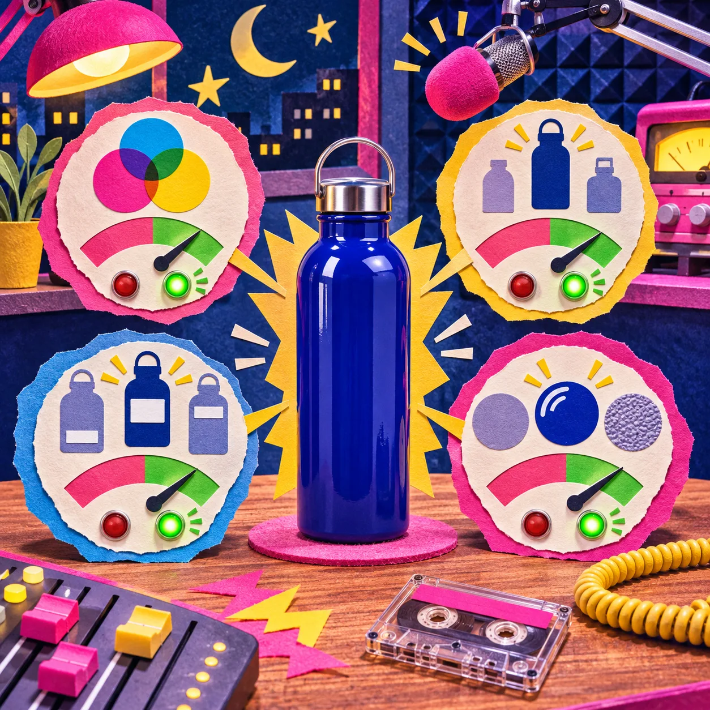
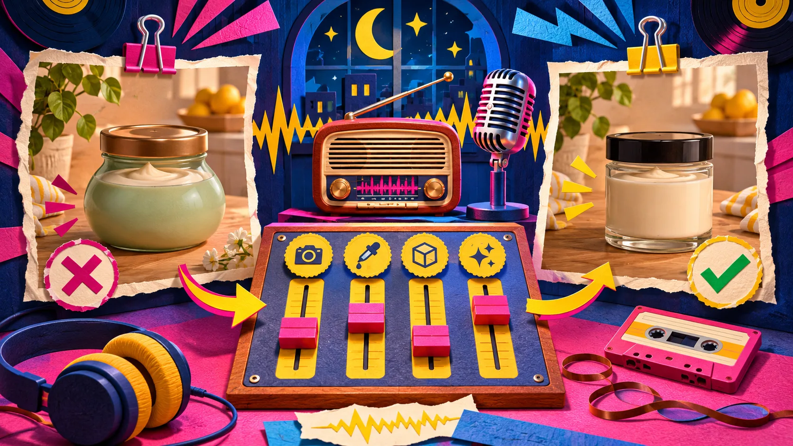
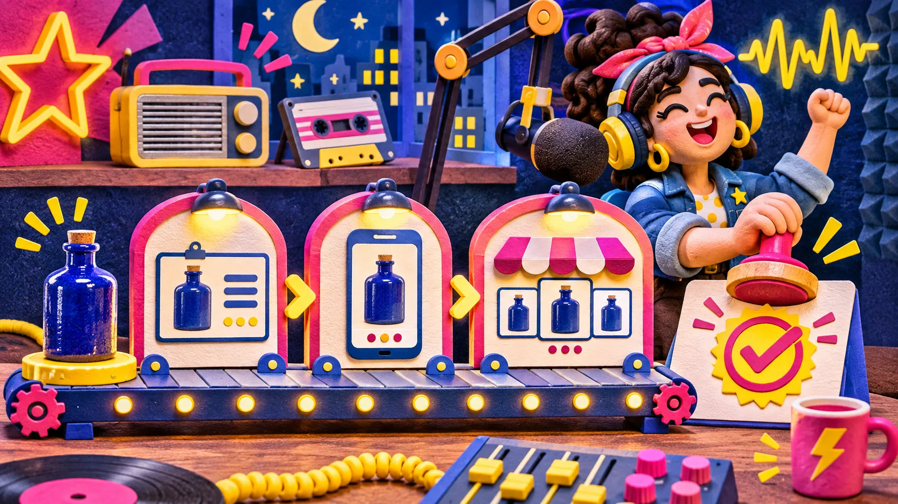

Una imagen creada con IA puede hacer que un producto parezca más atractivo y, al mismo tiempo, cambiar justo lo que el cliente necesita reconocer. La forma más sencilla de evitarlo es preparar una **ficha de invariantes**: cuatro rasgos del producto que la imagen no puede alterar antes de subirla a Shopify.

La ficha no convierte la revisión en una auditoría interminable. Sirve para separar una mejora útil —mejor luz, fondo o contexto— de una imagen bonita pero engañosa. Es especialmente práctica si usas [Supra AI Photo Studio](https://apps.shopify.com/supra-ai-photo-studio) para crear escenas lifestyle, retoques o imágenes con modelo a partir de una foto de catálogo.

## La ficha mínima: cuatro cosas que no deben moverse

Antes de generar una escena, abre la foto original y anota los rasgos que un comprador usaría para comprobar que ha elegido el artículo correcto. Para una botella, no importa si cambia la mesa; sí importa el azul exacto, la tapa, el logo o la textura. Para una camisa, la silueta, el estampado y el tipo de cuello pesan más que el parque donde aparece el modelo.

| Invariante | Pregunta de control | Cambio aceptable | Señal para descartar |
|---|---|---|---|
| Color | ¿El tono sigue siendo el de la variante vendida? | Luz más cálida o fría, si no altera la percepción del color | El azul se vuelve turquesa o el negro parece gris |
| Forma y proporción | ¿El contorno, tamaño y piezas visibles coinciden? | Una perspectiva distinta que no oculte partes clave | Asa, tapa, bolsillo o volumen que no existen |
| Marca, etiqueta y diseño | ¿Los detalles identificables siguen donde deben? | Ninguno: si no se puede leer, usa otra foto de apoyo | Letras falsas, logotipo deformado o estampado nuevo |
| Material y acabado | ¿Se entiende el material que recibirá el cliente? | Reflejos y sombras realistas | Tela convertida en cuero, cerámica en metal, acabado inexistente |

Piensa en estos puntos como condiciones de publicación, no como ideas para un prompt. Una escena puede ser creativa; el producto no debería convertirse en otro.

## Un ejemplo con una sola taza

Imagina una taza de cerámica azul, mate, con asa redonda y un pequeño sello blanco cerca de la base. Pides una imagen de cocina para una campaña de otoño. La IA devuelve una mesa preciosa, pero la taza es brillante, el asa parece más cuadrada y el sello se ha movido.

La respuesta no es “casi está”. Para una imagen de ficha, fallan tres invariantes. Puedes volver al editor y pedir una escena menos ambiciosa, o reservar esa toma para una pieza editorial que no se presente como la foto principal del producto. La [guía de Shopify sobre media de producto](https://help.shopify.com/en/manual/products/product-media) recuerda que las imágenes, vídeos y modelos ayudan a que el cliente entienda función y tamaño: esa promesa pierde fuerza cuando el objeto cambia.

## Cómo usar la ficha en Supra AI Photo Studio

La aplicación ofrece mejora de imagen, eliminación de fondo, escenas lifestyle, pruebas con modelo y vídeo a partir de imágenes de producto. La clave no es activar todas las funciones; es elegir una que respete el rasgo que quieres conservar.

1. **Empieza por la fuente más limpia.** Elige una foto nítida, con el producto completo y sin reflejos que oculten etiquetas o bordes. Si el archivo llega de un proveedor, primero aplica el filtro de entrada que explicamos en [fotos RAW de proveedores](https://herramientas-y-tutoriales.github.io/2026/11/11/fotos-raw-de-proveedores-el-filtro-de-entrada-que-evita-errores-de-sub/): no conviene que la IA arregle una fuente que todavía no está confirmada.

2. **Aísla lo que debe permanecer.** Si vas a pedir un nuevo fondo o una escena, revisa que el contorno del producto sea claro. En la instrucción adicional, nombra solo los cuatro invariantes: “mantener color azul mate, asa redonda, sello blanco en la base y cerámica”. No prometas que una instrucción basta; úsala como recordatorio para la revisión posterior.

3. **Genera una versión, no una galería infinita.** Compara el resultado con la foto original a tamaño suficiente. Si falla un rasgo, identifica cuál antes de reintentar. Cambiar fondo, iluminación y ángulo a la vez hace más difícil saber de dónde vino el error.

4. **Asigna un trabajo a cada imagen.** La toma limpia responde “¿qué compro?”; la escena lifestyle responde “¿cómo encaja en mi vida?”. Ambas pueden convivir. Si la escena explica más contexto que detalle, no sustituye la foto de referencia. Esta idea amplía nuestra guía sobre [fotos lifestyle con IA sin perder el control](https://herramientas-y-tutoriales.github.io/2026/10/09/como-crear-fotos-lifestyle-para-shopify-con-ia-sin-perder-el-control/).

## El control de 90 segundos antes de publicar

Haz esta revisión en móvil y ordenador. En móvil se percibe antes si el color parece otra variante; en ordenador se ven mejor bordes, tipografías y texturas.

- Pon original y resultado lado a lado.
- Comprueba los cuatro invariantes sin mirar primero el fondo.
- Mira la galería completa del producto: ¿la imagen añade una respuesta o repite una toma?
- Abre la variante correspondiente. Si hay colores o tallas, confirma que la imagen no la atribuye a otro producto.
- Escribe un alt text que describa lo que realmente se ve, no una promesa de marketing.
- Si hay duda sobre forma, etiqueta o material, deja la imagen fuera de la ficha y conserva el original.

No hace falta que cada producto tenga el mismo número de fotos. Shopify permite usar imágenes, vídeo y otros medios de producto; lo importante es que cada uno dé información útil y sea apto para acceso público en la tienda. Para una colección con muchas variantes, además conviene revisar cómo se relacionan producto y muestra de color; esta guía sobre [variantes y productos enlazados](https://herramientas-y-tutoriales.github.io/2026/09/07/como-organizar-variantes-y-productos-enlazados-con-muestras-de-color-e/) evita que una foto correcta aparezca junto a la opción equivocada.

## Cuándo una imagen IA debe vivir fuera de la ficha

Una escena puede ser excelente para un anuncio o una publicación social y no ser adecuada como prueba de producto. Guárdala para ese uso si:

- el producto aparece muy pequeño;
- el encuadre oculta la pieza que distingue una variante;
- el modelo, la mano o la decoración inducen a pensar que incluye accesorios;
- la IA ha alterado cualquier invariante de la ficha;
- necesitas explicar una función con movimiento.

En este último caso, una pieza de vídeo puede responder mejor a la duda. Si preparas contenido para una ficha, mira también [dónde colocar un vídeo UGC en una página de producto Shopify](https://herramientas-y-tutoriales.github.io/2026/11/11/donde-colocar-un-video-ugc-en-una-pagina-de-producto-shopify/): el vídeo funciona mejor cuando responde una pregunta concreta, no cuando compite con todas las imágenes a la vez.

## Convierte la ficha en un hábito pequeño

Crea una nota por familia de producto con los cuatro invariantes y úsala cada vez que generes una escena. En Supra AI Photo Studio puedes partir de la imagen existente, mejorar iluminación o retirar el fondo; después, la ficha decide si el resultado merece entrar en la galería. No necesitas asumir que una imagen generada “convierte más”: necesitas que el cliente vea el mismo objeto que recibirá.

Empieza hoy con un solo SKU. Elige una foto limpia, define sus cuatro invariantes y genera una única escena. Si supera el control de 90 segundos, súbela como apoyo; si no, has evitado que una buena idea visual se convierta en una mala promesa de catálogo.
