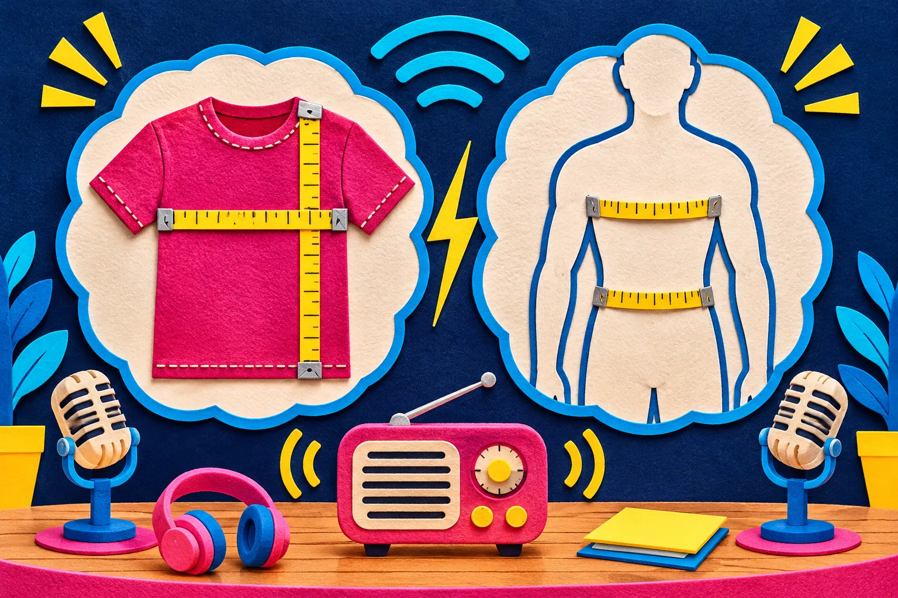
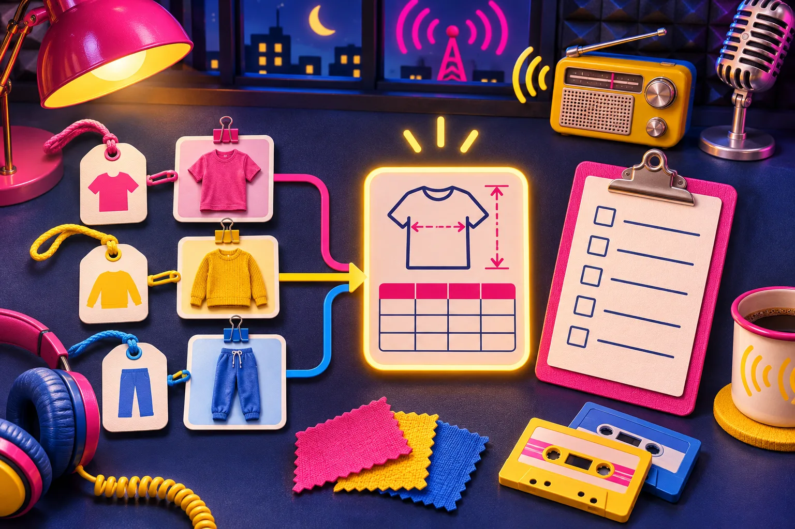
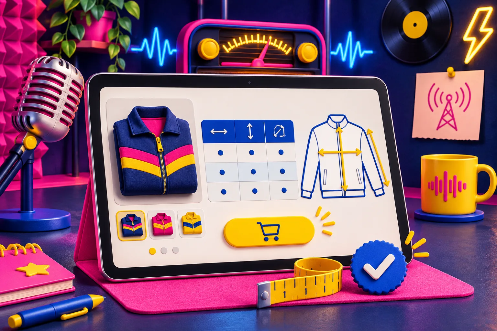

# Checklist de guía de tallas para Shopify antes de publicar

Una guía de tallas útil no necesita ser enorme: necesita decir **qué se ha medido, cómo debe leerse y a qué productos se aplica**. Antes de publicarla, comprueba esos tres puntos y prueba la ficha desde el móvil. Así reduces dudas razonables sin prometer que una tabla puede predecir el ajuste de cada persona.

El problema aparece cuando la guía llega al final del lanzamiento: una tabla copiada de un proveedor, medidas sin contexto y, con suerte, un botón que nadie encuentra. La tienda queda bonita, pero el cliente sigue sin saber si debe comparar su cuerpo, una prenda que ya le queda bien o una talla de otra marca.

Para una colección pequeña se puede corregir a mano. Cuando el catálogo crece, conviene centralizarlo. [Supra Size Chart](https://supra-size-chart.sktch.io/) permite crear una tabla, añadir una guía visual de medición y asignarla por producto, colección, tipo, proveedor o etiqueta desde un bloque de tema de Shopify. La ficha de la [Shopify App Store](https://apps.shopify.com/supra-size-chart) confirma además que el contenido se puede importar y exportar como CSV o JSON.

## La checklist: seis comprobaciones antes de pulsar Publicar

### 1. Decide si la tabla mide el cuerpo o la prenda

Este es el dato que más evita interpretaciones equivocadas. Una medida corporal indica, por ejemplo, el contorno de pecho de la persona. Una medida de prenda indica el ancho o largo de la camiseta ya extendida. No son intercambiables.

Ponlo junto al título de la tabla, no escondido en una nota final. Si usas medidas de prenda, explica el gesto: “mide una prenda similar en plano, de axila a axila”. Si usas medidas corporales, aclara cómo colocar la cinta y si debe quedar ajustada o con holgura. La guía [sobre dónde medirse antes de elegir talla](https://herramientas-y-tutoriales.github.io/2026/10/24/como-explicar-donde-medirse-antes-de-elegir-una-talla-en-shopify/) ayuda a convertir esa instrucción en algo fácil de seguir.

### 2. Comprueba que cada columna responde a una decisión

No copies una cuadrícula heredada solo porque existe. Para una sudadera, pecho, largo y manga pueden ser suficientes; para un pantalón, cintura, cadera, tiro y largo interior suelen ser más útiles. Añade “holgura” o “ajuste” cuando el diseño sea deliberadamente amplio o ceñido.

Una forma rápida de revisar la tabla es esta:

| Si el cliente pregunta… | La guía debe responder… |
| --- | --- |
| “¿Qué talla comparo con mi prenda favorita?” | qué medida tomar y en qué punto |
| “Estoy entre dos tallas” | si conviene priorizar amplitud, largo o ajuste |
| “¿Es la misma talla que en otra marca?” | que las tallas no se comparan por letra; se comparan por medidas |
| “¿Me sirve desde otro país?” | unidad disponible y conversión coherente |

Si una columna no cambia la elección, es ruido. Si una pregunta frecuente no tiene respuesta, falta contexto.

### 3. Enseña el punto de medición, no solo los números

Una línea dibujada sobre una silueta evita que “pecho” signifique una cosa para la tienda y otra para quien compra. Es especialmente importante con prendas de cortes poco evidentes, ropa infantil, trajes de baño o accesorios. Una guía visual no sustituye la explicación, pero hace que la explicación sea comprobable en segundos.

En Supra Size Chart se puede reutilizar una guía de medición junto a varias tablas. Úsala cuando el método sea igual; crea otra cuando cambie de verdad el patrón o el lugar de la medida. Esa distinción mantiene el catálogo ordenado sin borrar diferencias reales entre productos.

### 4. Revisa la cobertura de catálogo con reglas, no con memoria

Haz una lista de las colecciones que deben llevar guía y de las que no. Una colección de camisetas básicas puede compartir tabla; una cápsula de corte oversize quizá necesite otra. Después, abre tres fichas al azar: una antigua, una recién creada y una con varias variantes.

Las reglas por colección, tipo, proveedor o etiqueta sirven para que una incorporación futura no dependa de que alguien recuerde pegar HTML. También vale la pena aplicar el mismo orden que usas para [categoría, tipo y metafield en Shopify](https://herramientas-y-tutoriales.github.io/2026/11/11/categoria-tipo-y-metafield-la-hoja-de-ruta-para-ordenar-shopify/): antes de automatizar, define qué dato manda y evita etiquetas ambiguas.

### 5. Elige dónde se ve según el momento de decisión

Una tabla en línea funciona cuando el tamaño es el freno principal de compra y hay pocas medidas. Un acordeón conserva una ficha compacta si la tabla incluye notas o varias unidades. Un modal puede servir para una guía visual amplia, siempre que su botón tenga un nombre claro y sea fácil de tocar en móvil.

No elijas la opción “más limpia” sin mirar el resultado en una pantalla pequeña. En esa revisión comprueba que la guía aparece antes de una decisión crítica, que no tapa las variantes y que el contraste permite leer encabezados y cifras. La misma disciplina de revisión previa que usarías para [una foto de producto](https://herramientas-y-tutoriales.github.io/2026/11/04/como-revisar-una-foto-de-producto-antes-de-publicarla-en-shopify/) también aplica aquí: mira la ficha como la verá alguien que no conoce tu catálogo.

### 6. Guarda una salida y deja una vía de corrección

Una buena guía cambia cuando cambia la prenda, no solo cuando llega una devolución. Conserva la fuente de las medidas, la fecha y quién la validó. Si trabajas con CSV, mantenlo como archivo de revisión; si adaptas una tabla, anota el motivo.

La ventaja de usar datos estructurados en lugar de tablas repetidas dentro de descripciones es que una corrección puede propagarse de forma controlada. Supra Size Chart guarda las guías en metaobjetos de la tienda y permite exportar CSV o JSON; eso facilita revisar y mover los datos sin depender de una copia de texto perdida. Aun así, exportar no reemplaza una revisión: abre la ficha publicada después de cada cambio importante.

## Prueba final de cinco minutos

Antes de lanzar una colección, haz esta prueba con alguien que no haya preparado la tabla:

1. Pídele que encuentre la guía desde el móvil.
2. Que te diga si debe medir el cuerpo o una prenda.
3. Que elija una talla hipotética y explique por qué.
4. Que cambie a la unidad que usa habitualmente, si vendes en más de un mercado.
5. Que abra otro producto de la misma familia para confirmar que recibe la guía correcta.

Si se atasca, no es una prueba de atención del cliente: es una señal para mejorar el rótulo, la nota o la regla. Y si necesitas ordenar las fichas antes de empezar, este enfoque de [reutilizar contenido de Shopify sin repetir texto](https://herramientas-y-tutoriales.github.io/2026/10/19/como-reutilizar-contenido-de-shopify-sin-repetir-texto/) da un buen punto de partida.

## Empieza por una familia, no por todo el catálogo

No hace falta rehacer cien fichas en una tarde. Elige una familia con dudas de talla recurrentes, acuerda qué se mide, crea su tabla y pruébala en móvil. Después aplica las reglas a los productos que de verdad comparten patrón.

[Instala Supra Size Chart gratis](https://apps.shopify.com/supra-size-chart) si quieres centralizar esa primera guía, reutilizar la explicación visual y mantener las tablas fuera del HTML de cada descripción. El objetivo no es borrar todas las dudas de ajuste; es darle a cada comprador la información concreta que necesita para decidir con más seguridad.
