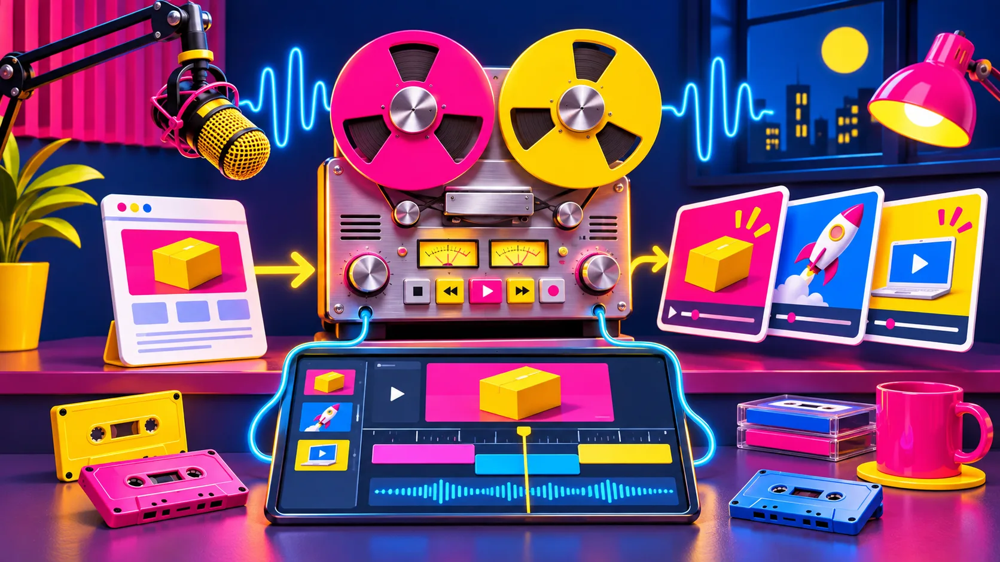
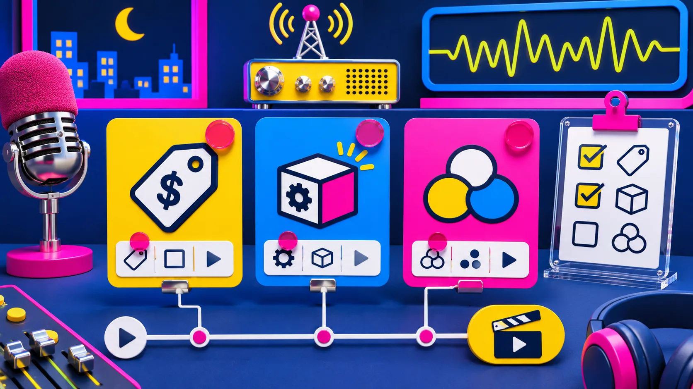
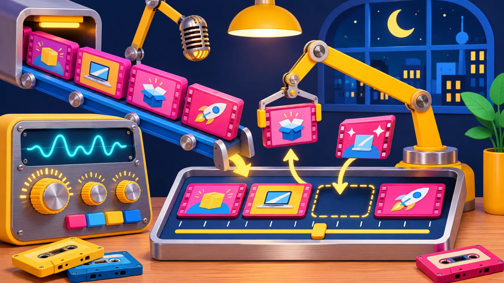
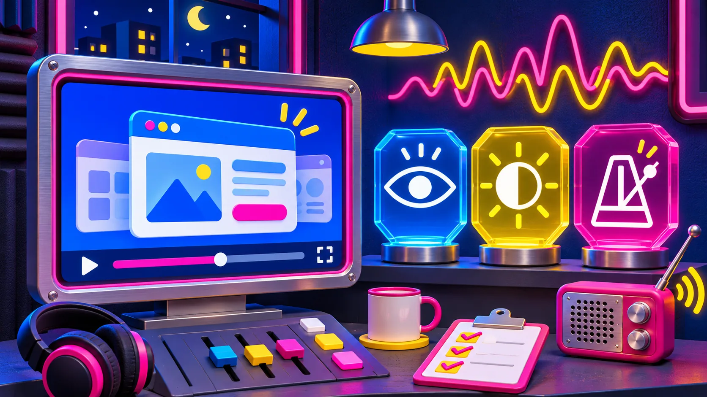

# Qué cambios de tu vídeo de lanzamiento exigen un nuevo renderizado

Cuando cambian el precio, una promesa o una pantalla del producto, no siempre hace falta rehacer tu vídeo de lanzamiento desde cero. La clave es distinguir un cambio de **mensaje** de un cambio meramente **local**: el primero obliga a revisar la historia completa; el segundo puede resolverse en una escena, siempre que conserves un proyecto editable y hagas una revisión final.

Para un equipo pequeño, esa diferencia evita dos problemas comunes: publicar un vídeo que ya no refleja el producto o gastar una tarde entera en regrabar una pieza que solo necesitaba un ajuste. [VideoFlow Studio](https://studio.videoflow.dev/) está planteado justamente para este flujo: parte de la web, genera una película de motion graphics y permite seguir editando el documento resultante desde el terminal o el editor.

## Primero: clasifica el cambio, no abras todavía el editor

Antes de pedir una modificación, escribe una frase: "ha cambiado ___ y por eso el espectador debe entender ___". Si la segunda parte cambia, estás ante un cambio de mensaje. No basta con sustituir un rótulo.

Esta es mi regla rápida para decidir el alcance:

| Si cambia… | Tipo de cambio | Qué revisar |
| --- | --- | --- |
| Una cifra, un color o una captura dentro de una escena | Local | Esa escena, su ritmo y el cierre |
| El nombre de una función o el orden de una demostración | De secuencia | La transición anterior y la siguiente |
| El precio, el público objetivo o la promesa principal | De mensaje | Guion, escenas, CTA y cualquier prueba visual |
| La identidad visual o la posición de marca | De sistema | Todas las escenas y los elementos repetidos |

Por ejemplo, cambiar la fecha de lanzamiento al final suele ser local. En cambio, pasar de "para equipos de ventas" a "para agencias" toca el problema inicial, las pruebas que eliges y la llamada a la acción. En ese caso, conviene volver al brief, no solo al montaje. Si aún estás construyendo el guion, esta guía sobre [convertir una web SaaS en un guion de vídeo de lanzamiento](https://herramientas-y-tutoriales.github.io/2026/11/08/como-convertir-una-web-saas-en-un-guion-de-video-de-lanzamiento/) te ayuda a fijar esa columna vertebral.

## La prueba de las tres preguntas

Antes de lanzar otro renderizado, responde en orden:

1. **¿La primera escena sigue siendo cierta?** Si el gancho describe una necesidad que ya no atacas, rehace el planteamiento.
2. **¿La prueba sigue respaldando la promesa?** Una demo antigua puede ser visualmente bonita y, aun así, explicar una función secundaria.
3. **¿El CTA pide la acción correcta?** Una invitación a una lista de espera no sirve igual cuando ya estás vendiendo un plan.

Si respondes "no" a dos o más, trátalo como un nuevo primer corte. Si solo falla una y está contenida en una escena, prepara una edición acotada: qué se sustituye, qué se mantiene y qué debe conservarse en la transición. Este pequeño contrato evita el clásico "cambia esto" que termina alterando el ritmo de toda la pieza.

## Haz una solicitud de cambio que se pueda comprobar

Los cambios en lenguaje natural funcionan mejor cuando incluyen límites observables. Puedes reutilizar esta plantilla:

> Sustituye la escena [número o descripción] porque [hecho que cambió]. Mantén [mensaje, duración o recurso que no debe cambiar]. El espectador debe salir entendiendo [resultado]. Revisa especialmente [transición, contraste, precio, logo o CTA].

En VideoFlow Studio puedes dirigir el proceso desde tu terminal con `npx @videoflow/studio@latest`; el sitio oficial explica que el agente planifica, crea y revisa el vídeo, y que el resultado sigue siendo editable. El motor subyacente, [VideoFlow](https://github.com/ybouane/VideoFlow), es de código abierto bajo licencia Apache-2.0; eso no convierte por sí solo cada cambio en algo pequeño, pero sí separa el proyecto editable del archivo final de vídeo.

### Cuándo elegir terminal y cuándo elegir editor

Usa una instrucción en el terminal cuando el cambio sea narrativo o afecte varias piezas relacionadas: por ejemplo, reemplazar una propuesta de valor y ajustar las escenas que la demuestran. Abre el editor cuando la decisión sea visual y concreta: ajustar una pausa, mover un elemento, cambiar un color o retocar un texto ya aprobado.

No es una cuestión de prestigio técnico. Es una cuestión de dejar claro qué debe permanecer estable. Si dudas entre ambos caminos, mira [cómo elegir entre crear tu vídeo de lanzamiento en terminal o navegador](https://herramientas-y-tutoriales.github.io/2026/11/08/como-elegir-entre-crear-tu-video-de-lanzamiento-en-terminal-o-navegado/).

## El control de calidad que no debes saltarte

Un renderizado nuevo no es una aprobación automática. Reserva una pasada final, aunque la modificación parezca pequeña. Revisa estos cuatro puntos:

- **Verdad:** precios, nombre de funciones, capturas y CTA coinciden con la web actual.
- **Lectura:** el texto importante se entiende a tamaño de móvil y mantiene contraste suficiente.
- **Ritmo:** la nueva escena no hace que la transición anterior parezca precipitada o demasiado lenta.
- **Continuidad:** colores, logotipo y tono no saltan de una escena a otra.

Para revisar con alguien que no usa tu herramienta de vídeo, puede ser útil [extraer fotogramas de un vídeo para una revisión con cliente](https://herramientas-y-tutoriales.github.io/2026/11/04/como-extraer-fotogramas-de-un-video-para-una-revision-con-cliente/). Así las observaciones se anclan a momentos visibles y no a impresiones vagas.

## Una decisión simple para no rehacer de más

Rehaz el vídeo cuando haya cambiado la promesa, el público o la prueba principal. Edita una escena cuando el cambio sea puntual, siga siendo coherente con el guion y puedas verificarlo con la lista anterior. La ventaja de trabajar con un proyecto que permanece editable no es evitar todas las revisiones: es convertirlas en decisiones pequeñas, trazables y honestas.

Si tienes una landing actualizada y necesitas un primer corte que puedas seguir afinando, entra en [VideoFlow Studio](https://studio.videoflow.dev/), prueba el flujo con tu URL y escribe primero el cambio que no estás dispuesto a perder de vista.
