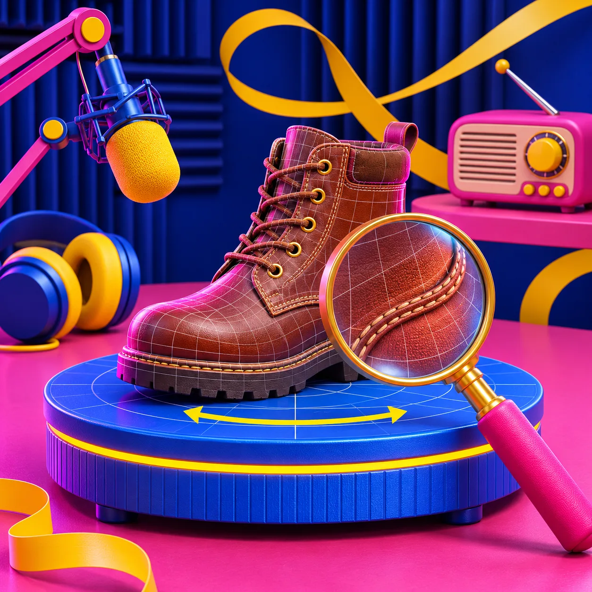

# Cómo Revisar un Modelo 3D de Shopify Antes de Publicarlo

Un modelo 3D puede aclarar la forma, el tamaño y los acabados de un producto mucho mejor que otra foto, pero solo si se revisa como una pieza de la ficha, no como un archivo que ya salió del escáner. Antes de publicar, haz una vuelta corta por forma, material, escala y carga; si una de esas cuatro cosas falla, conserva las fotos y corrige el modelo. Con [Supra 3D Capture](https://supra-3d-capture.sktch.io/) puedes crear un GLB desde fotos guiadas tomadas con el móvil y enviarlo a Shopify, pero el último criterio sigue siendo el comprador que intenta decidir sin tener el producto en la mano.

Esta es una revisión de diez minutos para no publicar un modelo que parezca convincente de frente y extraño al girarlo. No promete que el 3D sustituya todas las fotos: sirve para cerrar dudas espaciales, mientras las fotos siguen explicando color, uso y contexto.

## Qué debe resolver el modelo antes de entrar en Shopify

Empieza por una pregunta sencilla: ¿hay algo que una persona no pueda entender con la galería actual? Un bolso con fuelle, una lámpara con profundidad, una taza con asa o una bota con suela son buenos candidatos. Si el producto se entiende por textura, ingredientes o una tabla de tallas, tal vez una foto bien preparada y una explicación clara tengan más prioridad. La guía sobre [qué productos Shopify merecen un modelo 3D primero](https://herramientas-y-tutoriales.github.io/2026/11/02/que-productos-shopify-merecen-un-modelo-3d-primero/) ayuda a escoger esa primera prueba.

Shopify admite modelos 3D en formato GLB y USDZ; el archivo puede llegar a 500 MB, aunque la plataforma optimiza modelos de más de 15 MB. El límite técnico no es una meta de calidad: un modelo ligero que conserve la silueta, las proporciones y los detalles que justifican la compra suele ser una mejor experiencia que un archivo pesado. [La documentación de tipos de media de Shopify](https://help.shopify.com/en/manual/products/product-media/product-media-types) también recuerda que el tema debe soportar modelos 3D para mostrarlos en la página.

## La ficha de control de cuatro pasadas

| Pasada | Pregunta que responde | Señal para retener la publicación |
| --- | --- | --- |
| Forma | ¿El objeto se reconoce desde todos los ángulos? | Huecos, bordes que se derriten, asa incompleta o base flotante |
| Material | ¿El acabado coincide con las fotos de referencia? | Cuero plástico, metal apagado, estampado borroso o reflejos absurdos |
| Escala | ¿La relación entre partes parece real? | Mango demasiado grueso, tacón comprimido o producto que se hunde en el suelo |
| Tienda | ¿Carga y se descubre bien en la ficha? | Visor ausente, miniatura confusa, giro lento o modelo colocado donde distrae |

Guarda una foto de referencia junto a la vista 3D durante la revisión. No busques perfección de videojuego; busca que no introduzca una expectativa falsa. La recomendación oficial de Shopify para evaluar un modelo insiste en revisar forma, proporciones, materiales, transparencias, aristas y posibles huecos desde todos los ángulos.

## Paso 1: gira el modelo como lo haría un cliente

Abre el modelo en un móvil y en un ordenador. Haz tres paradas: frente, perfil y parte posterior. Después gira despacio por la zona donde el producto cambia de volumen: la unión del asa, la suela, una cremallera, un borde brillante. Esa trayectoria es más útil que mirar diez segundos el ángulo bonito.

Anota únicamente defectos que cambien una decisión: una pieza desaparece, una costura parece un agujero, la base parece torcida o un detalle decorativo se confunde con una mancha. Si el objeto es transparente, muy reflectante o tiene pelo, evita presentar el resultado como una copia exacta: esos materiales requieren más cautela en cualquier flujo de fotogrametría.

Para llegar con una mejor materia prima a esta etapa, prepara primero el objeto, la luz y el fondo. Aquí tienes una guía para [preparar un producto para fotos 3D en Shopify con el móvil](https://herramientas-y-tutoriales.github.io/2026/10/26/como-preparar-un-producto-para-fotos-3d-en-shopify-con-tu-movil/). Supra 3D Capture indica que su flujo toma más de diez fotos guiadas, procesa el resultado y permite pulir el modelo antes de publicarlo; úsalo para rehacer la captura cuando el error nace en el objeto, no para disimularlo con una miniatura.

## Paso 2: compara materiales y proporciones con evidencia

Pon una foto de producto limpia al lado del visor. Revisa estas parejas: color dominante frente a color dominante, brillo frente a brillo, y borde exterior frente a borde exterior. Si vendes una botella, revisa especialmente tapa, cuello y base; si vendes calzado, puntera, suela y altura.

Una regla práctica: si alguien pudiera confundir la variante, el tamaño o el material al tocar el visor, el modelo no está listo. Esto no se arregla añadiendo más adjetivos en la descripción. Conviene mantener también una galería de fotos honesta; la [revisión de foto de producto antes de publicarla](https://herramientas-y-tutoriales.github.io/2026/11/04/como-revisar-una-foto-de-producto-antes-de-publicarla-en-shopify/) es un buen control paralelo para que ambos medios cuenten la misma historia.

## Paso 3: revisa la ficha, no solo el archivo

Sube el modelo a un producto de prueba o a una ficha no indexada. Confirma que el tema muestra el control de 3D y que la miniatura no reemplaza la mejor imagen de portada: el primer media suele aparecer también en colecciones, carrito y otros lugares. Shopify explica que los modelos 3D no se pueden usar como media de variantes, así que no los conviertas en la única manera de distinguir un color o talla.

Prueba la ficha con una conexión móvil normal. Comprueba que la galería sigue siendo cómoda, que el botón para activar el 3D es visible y que el modelo no tapa precio, selector o llamada a la acción. Si tu tema no lo ofrece, actualízalo o usa una colocación alternativa como el bloque de aplicación de Online Store 2.0 de Supra 3D Capture, en vez de asumir que todos los temas lo renderizan igual.

## Paso 4: decide publicar, corregir o dejarlo para otro SKU

Usa esta decisión rápida al terminar:

- **Publica** cuando el modelo pasa las cuatro vueltas, aclara una duda espacial real y la ficha conserva buenas fotos.
- **Corrige y repite** cuando el fallo se concentra en una zona visible o la luz/las fotos de captura explican el defecto.
- **Pausa** cuando la superficie brillante, transparente o muy peluda sigue engañando, o cuando el tema no muestra el media con claridad.

No hace falta convertir todo el catálogo. Un único modelo publicado con controles claros te enseña más que veinte modelos que nadie puede encontrar. Si ya estás afinando otros elementos de la ficha, revisa también la [checklist de guía de tallas antes de publicar](https://herramientas-y-tutoriales.github.io/2026/11/13/checklist-de-guia-de-tallas-para-shopify-antes-de-publicar/): el 3D mejora la comprensión espacial, pero no sustituye las medidas.

## El primer modelo debe ser una prueba de confianza

El buen resultado no es “tenemos 3D”; es una ficha donde una persona puede girar el producto, entenderlo mejor y seguir comprando sin sorpresas. Elige un SKU de forma legible, crea el modelo con [Supra 3D Capture](https://apps.shopify.com/supra-3d-capture), pasa la ficha de cuatro vueltas y compárala con las fotos antes de activarla. Ese pequeño control editorial protege la confianza que querías ganar con el modelo.
