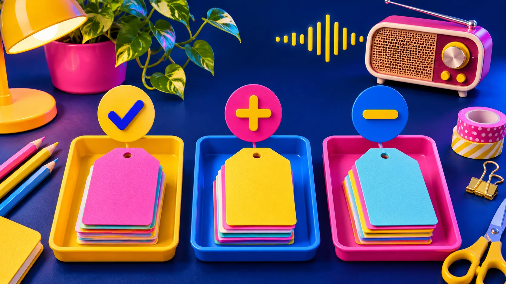
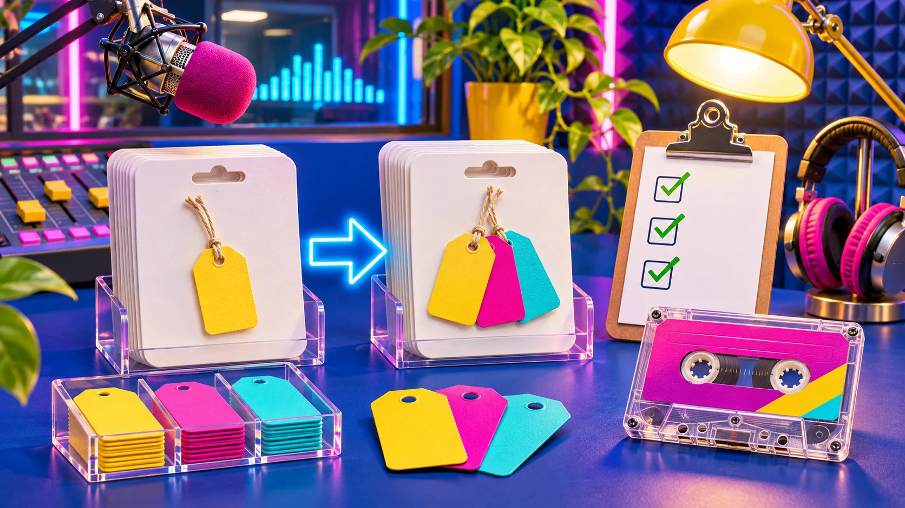

# Renueva etiquetas de Etsy por temporada sin borrar tus palabras clave

Cambiar las etiquetas de Etsy para una campaña estacional no debería significar empezar de cero. La forma segura es conservar las etiquetas que describen de verdad el producto, añadir solo los términos estacionales que encajan y retirar únicamente los que ya caducaron. Si tienes muchas fichas, [Bulk Listing Editor](https://bulk-listing-editor.webyze.com/) te permite aplicar esa decisión a un grupo seleccionado, pero el trabajo importante ocurre antes de pulsar **Bulk Update**.

La herramienta trabaja en tres pasos: buscar, seleccionar y aplicar una modificación; además permite añadir o retirar palabras clave en bloque. Eso es útil para un catálogo grande, pero también amplifica un criterio confuso. Esta guía propone una pequeña tarjeta de decisión para que una actualización de primavera, rebajas o regalos no borre los términos que ya explican qué vendes.

## La tarjeta de tres columnas: conservar, añadir y retirar

Antes de abrir el editor, elige entre 10 y 20 fichas que compartan intención. No agrupes todo lo que vende tu tienda solo porque llega una temporada: una taza, un pendiente y una lámina pueden necesitar búsquedas distintas aunque participen en la misma campaña. Para cada grupo, divide tus etiquetas actuales en tres columnas.

| Columna | Qué entra | Pregunta de control |
| --- | --- | --- |
| Conservar | Material, tipo de producto, destinatario o uso que sigue siendo cierto | ¿Seguiría describiendo el artículo en febrero? |
| Añadir | Un contexto estacional real y específico | ¿La ficha, foto o plazo de envío sostiene esta promesa? |
| Retirar | Una fecha, evento o campaña ya terminada | ¿Puede confundir a quien compre hoy? |

Por ejemplo, una taza de cerámica para regalo puede conservar términos sobre el material, la categoría y el destinatario. Puede sumar una etiqueta de regalos de invierno solo si la oferta y la logística la hacen relevante. No necesita sacrificar sus palabras centrales para hacer hueco mental a la campaña. Si la campaña terminó, retira únicamente el término estacional, no todo el conjunto.

Esta separación evita el error más común: tratar una etiqueta temporal como si sustituyera el significado del producto. Es parecido a ordenar una tienda antes de una modificación amplia de Shopify: en [esta guía sobre categoría, tipo y metafield](https://herramientas-y-tutoriales.github.io/2026/11/11/categoria-tipo-y-metafield-la-hoja-de-ruta-para-ordenar-shopify/) la lección también es no mezclar campos que responden a preguntas diferentes.

## Decide si el cambio pertenece a la ficha completa

Para etiquetas, trabaja en el modo de fichas completas: una etiqueta describe el anuncio, no una combinación concreta de talla o color. El modo de variaciones tiene sentido cuando el valor cambia por opción —por ejemplo, inventario, SKU o precio—. La distinción importa porque una actualización mal ubicada puede crear un conjunto desigual: algunos colores con contexto de temporada y otros sin él, aunque el comprador vea un solo producto.

En Bulk Listing Editor puedes filtrar fichas por palabra clave, intervalo de precio y estado, seleccionar el grupo exacto y preparar el cambio antes de aplicarlo. Aprovecha ese filtro para excluir artículos agotados, borradores o líneas que no comparten el mismo motivo de compra. Para cambios masivos de cualquier tipo, también ayuda la disciplina de [probar con un anuncio testigo](https://outils-et-tutoriels.github.io/2026/11/17/tester-une-modification-shopify-en-lot-avec-un-echantillon-temoin/): el lote pequeño no es burocracia; es información barata.

## Haz una prueba con una ficha testigo

No publiques una regla sobre cien fichas sin verla en una. Elige una ficha representativa y anota tres cosas antes de editarla: sus etiquetas que deben quedarse, la etiqueta que vas a añadir o retirar, y el motivo. Después de aplicar el cambio al anuncio testigo, comprueba la ficha como la vería una persona: título, fotos, disponibilidad y la promesa estacional deben contar la misma historia.

Si la ficha testigo no pasa, no intentes compensarlo añadiendo más etiquetas. Vuelve a la tarjeta de tres columnas. Quizá el evento no encaja con ese producto; quizá el grupo de búsqueda era demasiado amplio. Esta precaución es especialmente valiosa si también estás preparando imágenes: una [ficha de invariantes para fotos de producto](https://herramientas-y-tutoriales.github.io/2026/11/12/ficha-de-invariantes-para-revisar-fotos-ia-antes-de-subirlas-a-shopify/) sirve como recordatorio de que el producto debe seguir siendo reconocible aunque cambie el contexto.

## Aplica un solo cambio con un nombre claro

Cuando el testigo esté bien, vuelve a buscar el grupo y selecciona únicamente las fichas con la misma decisión. Haz una pasada por cada intención:

1. Añade una etiqueta estacional a las fichas elegibles.
2. Revisa el pre-flight check del editor y confirma cantidad y tipo de modificación.
3. Ejecuta la actualización.
4. Retira una etiqueta ya vencida en una segunda pasada, si corresponde.

Separar añadir y retirar tiene una ventaja práctica: si algo no cuadra después, sabes cuál de las dos operaciones revisar. No es necesario imponer esa regla en tiendas pequeñas, pero se vuelve muy útil cuando repites la misma actualización en varias colecciones. Para otro ejemplo de revisión antes de publicar, mira esta [checklist de guía de tallas](https://herramientas-y-tutoriales.github.io/2026/11/13/checklist-de-guia-de-tallas-para-shopify-antes-de-publicar/): una comprobación breve evita que un detalle de catálogo llegue al cliente.

## Guarda un recibo de cambio de dos líneas

Al terminar, deja una nota simple fuera del editor: fecha, grupo afectado, etiqueta añadida, etiqueta retirada y ficha testigo. No hace falta una hoja enorme. Ese recibo responde rápido a dos preguntas que suelen aparecer semanas después: “¿cuándo pusimos esta campaña?” y “¿qué debería deshacer al terminar?”.

Este hábito también hace más fácil revisar resultados sin atribuir cambios de tráfico a una sola causa. Las etiquetas no sustituyen fotos claras, stock correcto, precio ni una propuesta coherente. Si estás reorganizando una familia de productos, puedes complementar esta revisión con la guía sobre [qué información va en acordeones de Shopify](https://herramientas-y-tutoriales.github.io/2026/10/19/como-elegir-que-informacion-va-en-acordeones-de-shopify/): cada dato merece el lugar que mejor responde a la duda del comprador.

## Cuándo no conviene editar en lote

Pausa si las fichas tienen destinatarios, materiales o fechas de entrega distintas; si algunas fotos no muestran el uso estacional prometido; o si aún no sabes qué términos conservar. En esos casos, dos o tres grupos pequeños son mejores que una gran actualización elegante pero imprecisa.

La siguiente vez que cambies una campaña, no pienses “¿qué etiquetas pongo?”. Pregunta “¿qué parte de esta ficha sigue siendo verdad todo el año, qué parte cambia ahora y qué evidencia tengo?”. Con esa tarjeta, una ficha testigo y el [pre-flight check de Bulk Listing Editor](https://bulk-listing-editor.webyze.com/), puedes renovar un catálogo sin borrar la descripción que ya ayuda a tus clientes a encontrarlo.
