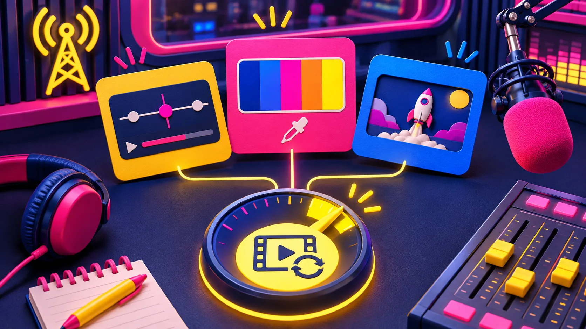
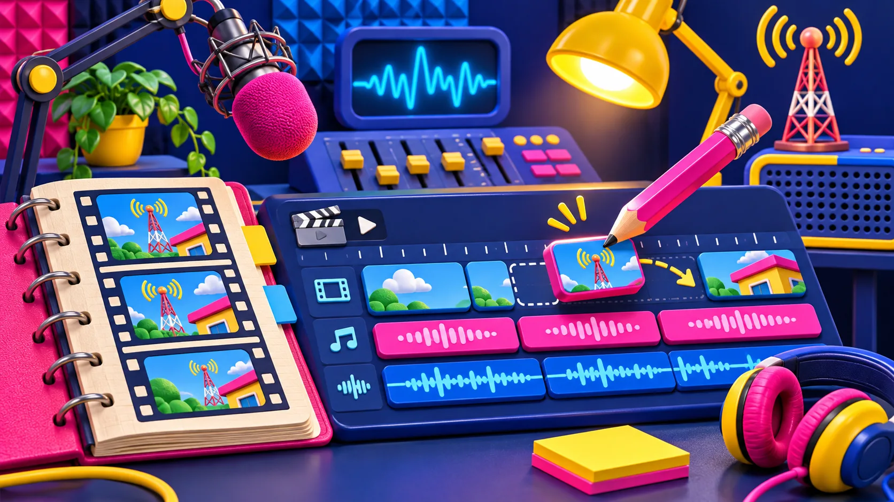
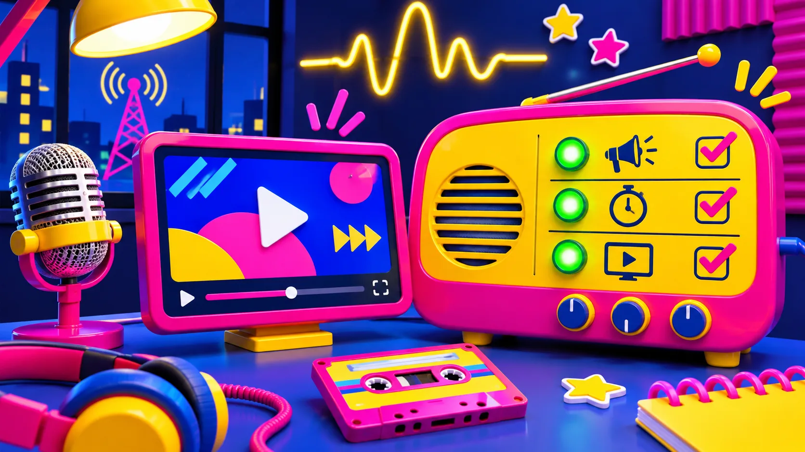

# Cómo pedir cambios en un video de lanzamiento sin rehacerlo

Cuando el primer corte de un video de lanzamiento no encaja, no siempre hace falta empezar de cero. Si el proyecto conserva sus escenas, capas y tiempos editables, puedes señalar qué debe cambiar, revisar el nuevo corte y mantener lo que ya funciona. Con [VideoFlow Studio](https://studio.videoflow.dev/), una URL de producto puede convertirse en un tráiler y el resultado sigue siendo un proyecto que puedes dirigir con una instrucción o ajustar en el editor.

La clave está en pedir un cambio concreto: una escena, un mensaje, un ritmo o una pantalla final. No en mandar un vago «hazlo más dinámico» y cruzar los dedos.

## Antes de pedir otro render: separa el problema

Un buen cambio empieza por nombrar el problema que ve el público. Esta pequeña tabla evita que un ajuste local se convierta en una reconstrucción completa:

| Si ocurre esto | Pide este tipo de cambio |
| --- | --- |
| La promesa tarda demasiado en aparecer | Acorta la apertura y lleva el beneficio principal a la primera escena |
| Una función importante no se entiende | Sustituye la escena por un ejemplo visual de esa función |
| El video parece correcto, pero pesado | Recorta una transición, una frase o un plano repetido |
| La marca cambió de precio o mensaje | Actualiza solo las escenas y la pantalla final afectadas |
| Hay un problema de contraste, alineación o texto | Corrige ese elemento y vuelve a revisar el render |

Esta distinción también ayuda a saber qué no pedir. Si el posicionamiento del producto cambió por completo, probablemente necesitas un nuevo brief y una nueva estructura. Pero si tu oferta sigue siendo la misma y una escena no la expresa bien, una revisión dirigida es más sensata.

En el artículo sobre [qué revisar en el primer corte de un video generado con IA](https://herramientas-y-tutoriales.github.io/2026/10/31/que-revisar-en-el-primer-corte-de-un-video-de-lanzamiento-generado-con/) encontrarás una lista útil para detectar ese tipo de fallos antes de compartir el video.

## Escribe una instrucción que el proyecto pueda conservar

Una petición útil contiene cuatro piezas: el lugar, el cambio, el motivo y lo que debe mantenerse. Por ejemplo:

> En la escena 3, sustituye la lista de funciones por una demostración de cómo se resuelve el problema principal. Mantén los colores, la duración total y la pantalla final; necesito que el beneficio se entienda antes del segundo 15.

Eso es mejor que «mejora la escena 3» porque deja claro el límite de la edición. VideoFlow Studio se puede ejecutar desde la terminal con `npx @videoflow/studio@latest`; su documentación explica que el flujo investiga la web, planifica el film, lo renderiza y revisa los fotogramas antes de entregar el resultado. También permite retomar un proyecto y solicitar una edición en lenguaje natural desde el mismo directorio de trabajo.

Si aún estás decidiendo dónde trabajar, esta guía sobre [terminal o navegador para crear un video de lanzamiento](https://herramientas-y-tutoriales.github.io/2026/11/08/como-elegir-entre-crear-tu-video-de-lanzamiento-en-terminal-o-navegado/) te ayuda a elegir el punto de partida. Lo importante aquí es que el cambio se aplica sobre un proyecto estructurado, no sobre un MP4 sin piezas movibles.

## Usa un registro de cambios de una línea

Para cada ronda, apunta una sola frase por ajuste. Es un hábito sencillo, pero evita las órdenes contradictorias y permite comparar el corte nuevo con el anterior. Prueba esta plantilla:

- **Objetivo:** que el espectador entienda la propuesta antes del segundo 10.
- **Cambio:** mover la demostración a la escena 2 y eliminar la segunda lista de funciones.
- **Invariante:** conservar duración, paleta y cierre.
- **Prueba de salida:** una persona que no conoce el producto puede explicar qué resuelve el video.

Esta plantilla encaja bien con una web SaaS: primero identifica el mensaje que la página ya sostiene y luego decide qué merece una escena. Si estás todavía en esa fase, consulta [cómo convertir una web SaaS en un guion de video de lanzamiento](https://herramientas-y-tutoriales.github.io/2026/11/08/como-convertir-una-web-saas-en-un-guion-de-video-de-lanzamiento/).

## Revisa la versión nueva con tres preguntas

No basta con que el render termine. Reproduce el video sin explicar nada y comprueba:

1. **¿La primera idea llega pronto?** Si el beneficio principal aparece tarde, el espectador no tiene razón para seguir mirando.
2. **¿El cambio arregló el problema sin romper otra escena?** Mira el ritmo antes y después de la edición, no solo el fragmento retocado.
3. **¿La pantalla final conserva una acción clara?** URL, demo, lista de espera o producto: debe quedar una salida concreta.

Para cambios que afectan a la duración, al texto o a la marca, vale la pena revisar también [qué cambios exigen un nuevo renderizado](https://herramientas-y-tutoriales.github.io/2026/11/14/que-cambios-de-tu-video-de-lanzamiento-exigen-un-nuevo-renderizado/). Así eliges entre una corrección local y una nueva pasada de revisión sin añadir trabajo innecesario.

## Cuándo conviene abrir el editor manualmente

Las instrucciones en lenguaje natural son prácticas para cambios de mensaje, escena y ritmo. El editor manual es especialmente útil cuando ya sabes exactamente qué quieres tocar: mover una capa unos píxeles, ajustar un punto de entrada o probar una alternativa visual. Studio describe ambos caminos —seguir dirigiendo con una frase o mover elementos en el editor del navegador— como parte del mismo proyecto editable.

No confundas esto con prometer un resultado perfecto a la primera. La revisión humana sigue siendo necesaria: comprueba datos, nombres de producto, legibilidad en móvil y la coherencia entre lo que dice el video y la página a la que llevará.

## Un cambio pequeño, una mejora que se nota

Un video de lanzamiento mejora cuando cada revisión responde a una decisión, no cuando acumula versiones. Empieza por el problema visible, delimita lo que debe mantenerse y revisa el corte con una pregunta concreta.

Si quieres probar este flujo con la URL de tu producto, visita [VideoFlow Studio](https://studio.videoflow.dev/) y prepara primero una instrucción de cambio de una sola frase. Te dará una segunda versión mucho más fácil de evaluar.
