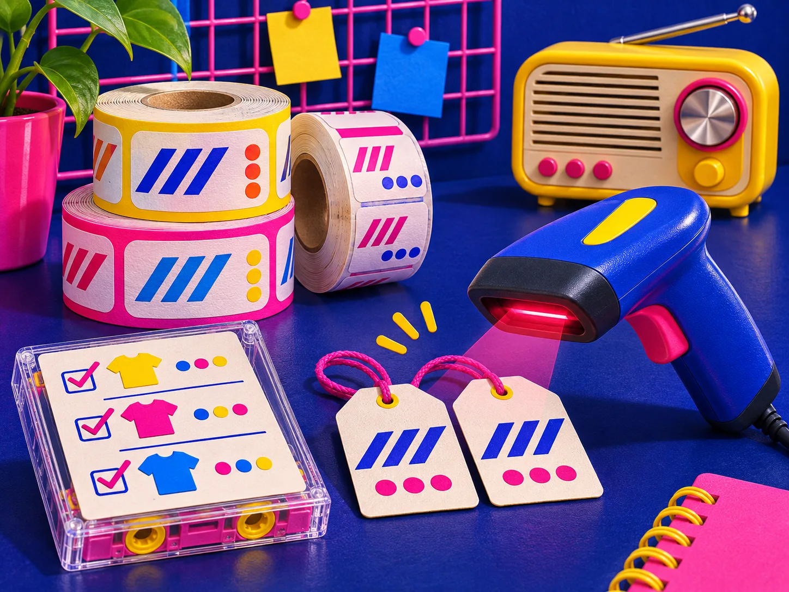

# Cómo renombrar SKU de Shopify en masa sin romper variantes

Cambiar SKU en masa no tiene por qué convertirse en una tarde de copiar y pegar. La clave es aplicar una regla de nombres a un grupo bien definido, probarla en una muestra y comprobar las variantes antes de ejecutar el lote completo. Con [Ultimator Bulk Editor](https://apps.shopify.com/ultimate-bulk-editor), puedes seleccionar productos o variantes, definir el cambio y ejecutarlo o programarlo; aun así, la decisión sobre qué SKU debe cambiar sigue siendo tuya.

Un SKU identifica una variante dentro de tu operación; no es un nombre decorativo. [Shopify distingue el SKU del código de barras y explica que los SKU sirven para identificar artículos dentro del negocio](https://help.shopify.com/en/manual/products/details). Si el mismo producto tiene talla y color, el SKU suele vivir en cada variante: ahí es donde una regla demasiado amplia puede causar el lío.

## La regla antes de la herramienta

Escribe una frase que alguien de operaciones pueda revisar sin abrir Shopify. Por ejemplo: "A todas las variantes activas de la colección verano cuyo SKU empieza por OLD-, reemplazar OLD- por SS26-; no tocar productos en borrador ni variantes sin SKU". Esa frase obliga a separar alcance, cambio y exclusiones.

No necesitas un código de SKU universal. Sí necesitas una convención que no cambie a mitad de catálogo. Una estructura razonable podría ser `LINEA-COLOR-TALLA`, como `SS26-AZUL-M`. Si tu almacén, ERP o proveedor ya usa otra estructura, conserva la parte que les permite reconocer el artículo: el objetivo es claridad operativa, no ganar un concurso de abreviaturas.

### Tarjeta de decisión para el lote

| Pregunta | Si la respuesta es sí | Si la respuesta es no |
| --- | --- | --- |
| ¿El cambio afecta a variantes? | Filtra y revisa al nivel de variante. | Revisa que realmente sea un dato de producto. |
| ¿Otro sistema conoce el SKU actual? | Avisa y guarda el mapa antiguo → nuevo. | Continúa con la muestra. |
| ¿Hay variantes sin SKU? | Exclúyelas y decide su regla aparte. | Inclúyelas solo si la regla es verificable. |
| ¿El cambio será programado? | Revisa el alcance de nuevo justo antes. | Ejecuta tras aprobar la muestra. |

[Shopify documenta una precaución especialmente útil al trabajar con datos de variantes](https://help.shopify.com/en/manual/products/import-export/using-csv): en su CSV de productos, los campos relacionados con una variante dependen de sus opciones; omitir campos relacionados puede cambiar el resultado de la importación. Aunque aquí no estés importando un CSV, la lección es la misma: trata las variantes como registros conectados, no como una línea aislada.

## Haz una muestra de 10, no un salto de fe

Crea primero una tarea en Ultimator para un grupo pequeño y reconocible: diez variantes que incluyan al menos dos colores, dos tallas y un artículo con inventario. La aplicación permite buscar o filtrar, editar productos y variantes, y ejecutar o programar la tarea. Para esta muestra, evita combinar el SKU con precio, etiquetas o estado: un solo tipo de cambio hace que el resultado sea fácil de leer.

Antes de aplicarla, anota para cada caso: URL del producto, título, opciones, SKU anterior y SKU esperado. Esta mini hoja es tu recibo de control. Si trabajas con cientos de referencias, es más útil que mirar una lista interminable después.

Después de la muestra, comprueba cuatro cosas:

1. Cada variante incluida recibió el prefijo, reemplazo o valor esperado.
2. Ninguna variante excluida cambió por compartir producto con una incluida.
3. Los SKU nuevos siguen siendo únicos donde tu operación lo requiere.
4. El buscador, el almacén o la integración que depende del SKU puede encontrar el valor nuevo.

Si falla una de esas cuatro, no amplíes el lote. Corrige el filtro o la regla y vuelve a probar. Es el mismo principio que usamos al [probar una actualización masiva con un catálogo piloto](https://herramientas-y-tutoriales.github.io/2026/10/09/como-probar-una-actualizacion-masiva-de-shopify-en-un-catalogo-piloto/): la muestra no es una formalidad, es donde descubres que un criterio parecía más preciso de lo que era.

## Ejecuta el lote completo con un mapa de reversión

Cuando la muestra esté bien, duplica mentalmente su control para el lote real: conserva el criterio, la regla y la fecha. Si vas a programarlo, vuelve a mirar cuántas variantes coinciden justo antes de la hora prevista; el catálogo puede haber cambiado desde que preparaste la tarea. Esta disciplina encaja con una [actualización masiva programada sin sorpresas](https://herramientas-y-tutoriales.github.io/2026/10/28/como-programar-una-actualizacion-masiva-de-shopify-sin-sorpresas/).

Guarda además una tabla sencilla de dos columnas: SKU anterior y SKU nuevo. No es una promesa de que cualquier sistema pueda revertir automáticamente el cambio; es una referencia para soporte, almacén y conciliación. Si también estás limpiando etiquetas, mantenlo en una tarea separada: [ordenar etiquetas sin romper la lógica del catálogo](https://how-to.the-lean-ecommerce.com/2026/11/16/how-to-clean-up-shopify-product-tags-without-breaking-collections/) es otro problema, con otra comprobación.

## Cierra con una comprobación que sí puedas repetir

Al terminar, busca cinco SKU nuevos elegidos de forma repartida: uno de cada familia de producto o proveedor importante. Abre la variante, compara sus opciones y confirma que el SKU anterior ya no aparece donde no debe. Después busca dos SKU antiguos: deberían seguir apareciendo solo en tu mapa de reversión, no como referencias activas.

Este cierre complementa la [guía para separar cambios de productos y variantes](https://how-to-blog.gitlab.io/2026/11/13/how-to-separate-product-and-variant-changes-before-a-shopify-bulk-edit/): primero decides el nivel correcto del dato; luego verificas resultados en ese mismo nivel. También te evita confundir SKU con categoría, tipo o metafield, que cumplen funciones distintas en Shopify.

## Cuándo no usar una actualización masiva

Detente si no puedes explicar qué sistema externo consume el SKU, si vas a cambiar opciones de variante a la vez, o si el catálogo contiene excepciones sin documentar. En esos casos, exportar una muestra, consultar al responsable de inventario y resolver las excepciones por separado suele ser más rápido que reparar una migración confusa.

Para un cambio claro y acotado, abre [Ultimator Bulk Editor en Shopify](https://apps.shopify.com/ultimate-bulk-editor), crea una tarea de muestra y revisa su resultado antes de escalar. Cambiar SKU por lotes funciona muy bien cuando la regla cabe en una frase y la verificación cabe en una pequeña tabla.
