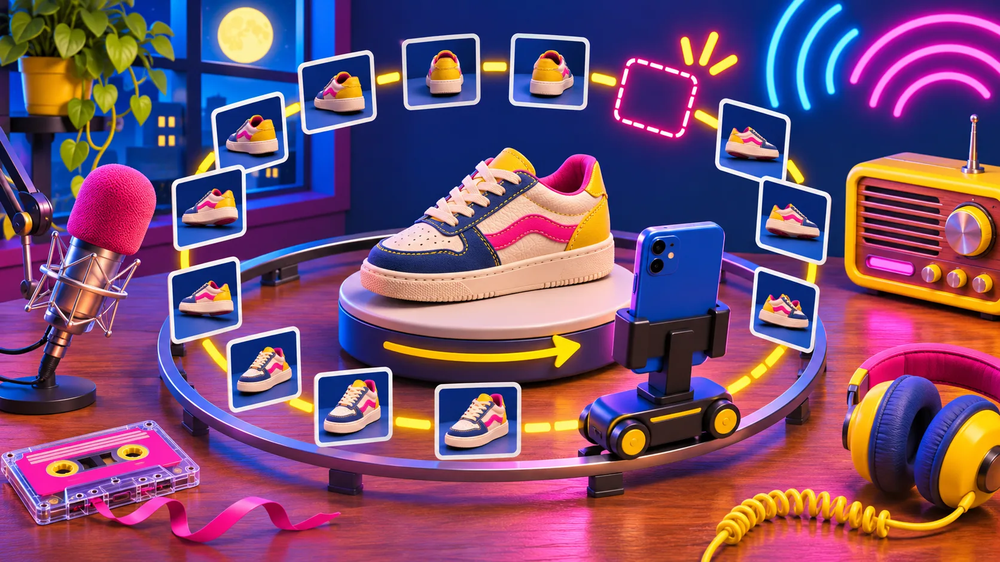
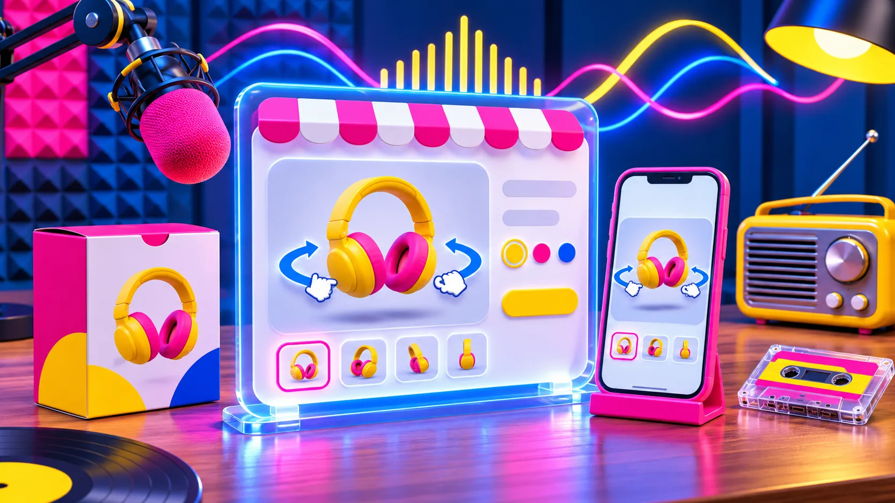

# ¿Está listo tu producto para un modelo 3D? Haz esta prueba antes de capturarlo

No todos los productos de Shopify son una buena primera captura 3D. La respuesta corta: empieza con una pieza mate, estable y con una silueta clara; prepara una órbita de fotos completa y comprueba el resultado en móvil antes de publicarlo. Los objetos transparentes, muy brillantes o con pelo no están prohibidos, pero requieren más control y no son el mejor piloto.

Un modelo 3D puede ayudar a que alguien examine forma, escala y detalles desde la página de producto. Shopify admite modelos 3D como media de producto y explica que el comprador puede verlos desde distintos ángulos; los archivos aceptados son GLB y USDZ. Eso no significa que haya que convertir el catálogo entero: significa que conviene elegir un SKU que permita aprender sin crear una cadena de retoques.

## La prueba de cuatro señales

Antes de abrir la cámara, puntúa el producto con esta tabla. No es una promesa de que el modelo saldrá perfecto; es una forma de decidir si el primer intento te enseñará algo útil.

| Señal | Verde: buen primer candidato | Amarillo: prueba con cuidado | Rojo: deja este SKU para después |
| --- | --- | --- | --- |
| Superficie | Mate, con textura o bordes claros | Algo satinada o con pequeños reflejos | Espejo, vidrio transparente o acabado cromado |
| Forma | Compacta, estable y separada del fondo | Tiene huecos o piezas finas | Pelo, transparencias o partes móviles difíciles |
| Cobertura | Puedes rodearla sin moverla | Un lado exige reorganizar la mesa | No puedes mostrar base, laterales o uniones |
| Luz | Luz uniforme y repetible | Hay alguna sombra que puedes suavizar | Reflejos duros que cambian en cada toma |

Una cafetera mate, una zapatilla, una lámpara de cerámica o una caja con relieve suelen dar señales verdes. Un frasco de perfume de cristal o una joya cromada no son malos productos: simplemente mezclan transparencia y reflejo, dos variables que merece la pena abordar cuando ya conozcas tu proceso.

Este filtro complementa la guía de [qué productos Shopify merecen un modelo 3D primero](https://herramientas-y-tutoriales.github.io/2026/11/02/que-productos-shopify-merecen-un-modelo-3d-primero/). Aquella decisión mira el valor comercial; esta prueba mira si el objeto está listo para ser capturado hoy.

## Haz una órbita corta, no una sesión heroica

La fotogrametría reconstruye un objeto a partir de fotos que se solapan. Para una primera prueba, fija el producto, limpia polvo y huellas, y deja que la iluminación sea constante. Después rodea la pieza manteniendo una distancia parecida y una altura coherente. Si tienes que cambiar de sitio o de luz a mitad de recorrido, repite la órbita: mezclar condiciones hace más difícil detectar la causa de un fallo.

[Supra 3D Capture](https://supra-3d-capture.sktch.io/) propone una captura guiada con 10 o más fotos desde el móvil, las procesa y prepara un GLB para Shopify. Su interés para una tienda pequeña no es sustituir criterio por un botón: es tener un recorrido repetible para probar una pieza sin contratar modelado 3D desde el primer día.

Usa este mini guion de captura:

1. Coloca el producto sobre un fondo sin brillo y revisa que no se balancee.
2. Da una vuelta completa; mira primero la silueta, no la pantalla.
3. Añade ángulos algo altos o bajos si hay una parte importante que la vuelta media no muestra.
4. Revisa que no falte una unión, una etiqueta o el lado que responde la duda habitual del comprador.

Si aún no tienes fotos coherentes, no fuerces el 3D. Empieza por [revisar una foto de producto antes de publicarla en Shopify](https://herramientas-y-tutoriales.github.io/2026/11/04/como-revisar-una-foto-de-producto-antes-de-publicarla-en-shopify/): la limpieza, la luz y el encuadre siguen importando aunque el resultado sea interactivo.

## Separa “modelo correcto” de “modelo útil en la ficha”

Un GLB que abre no es automáticamente una mejora de página. Shopify indica que los modelos de más de 15 MB se optimizan al subirlos y que el sistema prepara versiones GLB y USDZ para compatibilidad. Por eso la revisión debe hacerse en el contexto donde comprará la persona, no solo en el archivo original.

Mi revisión de cinco minutos tiene dos pasadas:

- **Pasada de objeto:** gira el modelo y busca zonas derretidas, cortes extraños, sombras pegadas o partes que parecen flotar.
- **Pasada de compra:** abre la ficha en móvil, intenta rotarlo con un dedo y pregúntate qué duda resuelve: grosor, trasera, textura, tamaño relativo o mecanismo.

En Shopify puedes añadir modelos desde la sección de media del producto; consulta los requisitos actuales en la [documentación de media de producto](https://help.shopify.com/en/manual/products/product-media/product-media-types). Si tu tema muestra el visor nativo o usas un bloque de aplicación de Online Store 2.0, revisa también el orden respecto a las fotos: el modelo debe aparecer donde aporta contexto, no desplazar la imagen principal que ya funciona.

Antes de pulsar publicar, compara tu lista con esta [revisión de un modelo 3D de Shopify](https://herramientas-y-tutoriales.github.io/2026/11/16/como-revisar-un-modelo-3d-de-shopify-antes-de-publicarlo/). Es especialmente útil para no confundir un procesamiento terminado con una experiencia lista para compradores.

## Convierte el piloto en una regla de catálogo

Guarda una pequeña ficha por SKU: fecha, tipo de superficie, condiciones de luz, fotos que faltaron, tamaño final y resultado de la prueba móvil. Con tres o cuatro pilotos, verás un patrón: quizá tus artículos mate y compactos van bien, mientras que los metálicos necesitan una sesión aparte. Esa observación vale más que una regla genérica de “todo debe tener 3D”.

También puedes decidir que algunas fichas necesitan mejores fotos, vídeo o una explicación de talla antes que un modelo. La prioridad depende de la pregunta que el cliente no logra resolver. Si el problema es la medida, una [guía de tallas revisada antes de publicar](https://herramientas-y-tutoriales.github.io/2026/11/13/checklist-de-guia-de-tallas-para-shopify-antes-de-publicar/) puede ser el siguiente paso más sensato.

Empieza con un producto verde, haz una sola órbita limpia y míralo en la ficha desde el móvil. Cuando el modelo responda una duda real sin crear otra, tendrás una base honesta para ampliar el 3D con [Supra 3D Capture](https://apps.shopify.com/supra-3d-capture).
