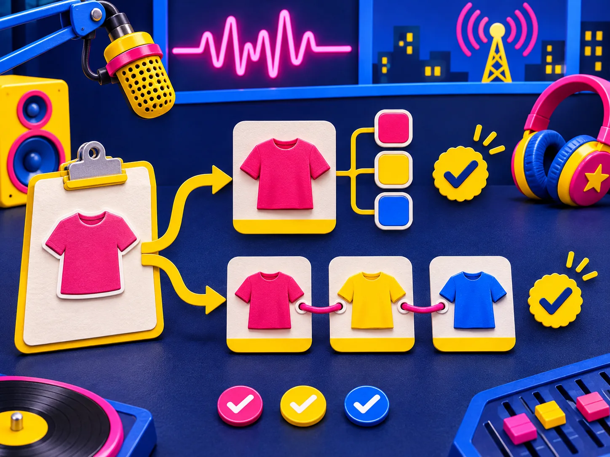

# Muestras de color en Shopify: cuándo usar variantes y cuándo enlazar productos

Si al tocar una muestra de color en tu tienda el cliente ve una foto, un precio o una disponibilidad que no corresponde, el problema no es decorativo: la estructura del catálogo y el selector no están contando la misma historia. La regla útil es simple: usa **variantes** cuando cambia el color de la misma compra; enlaza **productos separados** cuando el color necesita su propia ficha, contenido o lógica comercial. Después comprueba el resultado en producto y colección.

[Supra Swatch Colors](https://apps.shopify.com/swatch-colors-ultimator) permite mostrar muestras de color e imagen tanto para variantes como para grupos de productos enlazados, sin tener que convertir esta decisión en una reforma del tema. Pero primero hay que decidir qué representa de verdad cada color.

## La pregunta que evita un catálogo confuso

Shopify define una variante como una combinación de opciones de un mismo producto: por ejemplo, una camiseta pequeña y azul. Cada variante puede tener inventario propio. La documentación para temas añade una condición importante: al cambiar la variante, deben actualizarse los medios, el precio y el selector. Eso convierte una muestra en una pequeña promesa de interfaz, no en una bolita de color.

Usa esta tarjeta de decisión antes de configurar nada:

| Si el color cambia… | Elige | Por qué |
| --- | --- | --- |
| Solo el tono, el SKU, la foto y el stock de la misma prenda | Variante | El comprador sigue comparando la misma ficha |
| La composición, el corte, la historia, las fotos o el precio de forma sustancial | Producto enlazado | Cada opción merece una página con contexto propio |
| Un producto está agotado temporalmente | Variante publicada o no publicada según tu canal | Conservas su historial sin fingir que está disponible |
| No estás segura | Empieza con una variante en una copia de prueba | Comprueba el recorrido real antes de escalarlo |

No elijas productos separados solo porque haya muchos colores. Shopify admite hasta tres opciones por producto, pero esa capacidad no sustituye una decisión de merchandising. Si la versión verde necesita fotos propias, una descripción distinta y campañas distintas, tratarla como un enlace suele ser más honesto para la persona que compra.

## Haz una ficha por familia, no una lista de intuiciones

Toma una familia pequeña —por ejemplo, tres sudaderas— y anota una línea por color: nombre visible, SKU, imagen principal, precio, disponibilidad, URL y decisión: variante o producto enlazado. Esta ficha parece sencilla, pero evita dos tropiezos frecuentes: llamar “Rojo” a tres tonos distintos y enlazar una muestra a una foto que ya no existe.

Mantén el nombre que verá el cliente. Si el catálogo usa “Azul noche”, no lo reduzcas a “Azul” solo para que el selector parezca ordenado. La coherencia de nombres también ayuda cuando después revisas los resultados de una [actualización masiva de SKU](https://herramientas-y-tutoriales.github.io/2026/11/18/como-renombrar-sku-de-shopify-en-masa-sin-romper-variantes/).

Con **Supra Swatch Colors** puedes elegir muestras de color o imagen, enlazar páginas de producto y ajustar tamaño, forma, etiqueta y tooltip. La configuración es flexible; tu ficha es la que evita que esa flexibilidad se convierta en combinaciones accidentales.

## Configura una familia piloto y prueba los tres cambios

No empieces con toda la colección. Crea un grupo piloto y prueba cada muestra desde la ficha de producto. En cada clic, revisa estos tres cambios:

1. **Imagen:** ¿la foto principal representa el color seleccionado?
2. **Precio:** ¿aparece el importe y la oferta de esa variante o producto?
3. **Disponibilidad:** ¿el botón y el estado de stock coinciden con la opción?

La guía de Shopify para selectores de variantes exige precisamente que medios, precio y selector reflejen la variante elegida. Si una de estas tres piezas se queda atrás, no publiques aún: el cliente no debería descubrir la discrepancia en el carrito.

Un detalle técnico que merece cinco minutos: abre también la URL de una variante concreta. Shopify permite enlaces profundos con `?variant=`; ahí el producto debe cargar ya con la selección, la foto y el precio correctos. Es una prueba pequeña que protege enlaces de anuncios, correos y recomendaciones.

## Lleva la prueba a la colección y al móvil

La ficha de producto no es el único lugar donde una muestra puede crear expectativas. Si enseñas muestras en la colección, el cliente decide antes de abrir la ficha. Supra Swatch Colors incluye soporte para páginas de colección, pero conviene revisar qué ocurre cuando se cambia de color: ¿la tarjeta sigue llevando a la página correcta? ¿la imagen y el indicador de stock no contradicen la selección?

Haz este recorrido en móvil y escritorio: entra en una colección, toca dos muestras distintas, abre cada resultado y vuelve atrás. Después pruébalo con teclado si tu tema ofrece foco visible. Esta revisión complementa una [prueba de accesibilidad del selector](https://the-lean-ecommerce.github.io/2026/11/04/shopify-swatch-accessibility-keyboard-checklist/) y evita solucionar solo la versión de escritorio.

Si el objetivo es mostrar un color real de una prenda, una foto recortada puede ser más fiel que un círculo plano. Antes de usarla como muestra, aplica el mismo criterio de bordes y fondo que usarías al [revisar una foto de producto](https://herramientas-y-tutoriales.github.io/2026/11/21/recorta-fotos-de-producto-sin-inventar-detalles-metodo-de-revision/): la imagen debe describir el artículo, no embellecerlo hasta volverlo engañoso.

## Checklist de salida: cinco comprobaciones y una decisión

Antes de activar el grupo completo, repite esta lista con una persona que no haya configurado las muestras:

- El nombre de cada color coincide entre selector, foto y catálogo.
- Una muestra cambia imagen, precio y disponibilidad de forma coherente.
- Las variantes agotadas muestran el estado correcto; no desaparecen por sorpresa.
- Las muestras de colección llevan a la ficha correcta en móvil y escritorio.
- Un enlace directo de variante abre la selección correcta.

Si fallan dos o más puntos, vuelve a la ficha de familia: el problema suele ser de datos o de la decisión variante/producto, no de color. Si solo falla un punto visual, prueba primero en una copia del tema y documenta la corrección. Para una revisión más amplia del catálogo, puede servir esta guía sobre [muestras de color para una colección Shopify](https://herramientas-y-tutoriales.github.io/2026/10/13/como-elegir-muestras-de-color-para-una-coleccion-shopify/).

## Un selector claro es una decisión comercial clara

Las buenas muestras reducen una elección visual a una acción segura: este color, esta foto, este precio, esta disponibilidad. No hace falta que todas las opciones vivan en una sola ficha; hace falta que cada una tenga la estructura que explica mejor lo que se compra.

Empieza con una familia piloto y usa [Supra Swatch Colors](https://apps.shopify.com/swatch-colors-ultimator) para presentar variantes o productos enlazados de forma consistente. Cuando los cinco controles pasen en producto, colección y móvil, amplía el patrón al resto del catálogo.
