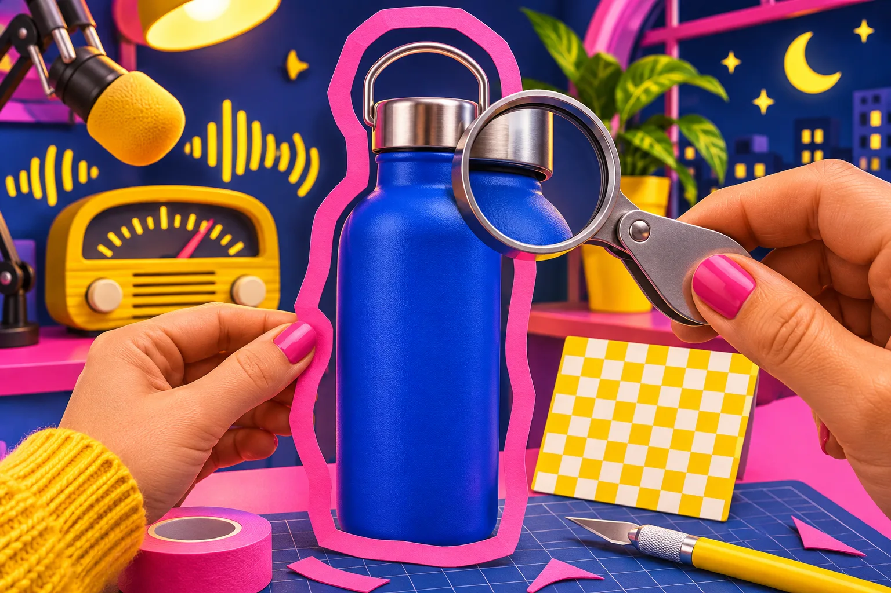
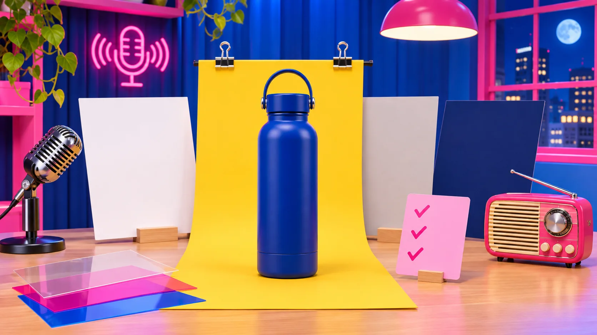
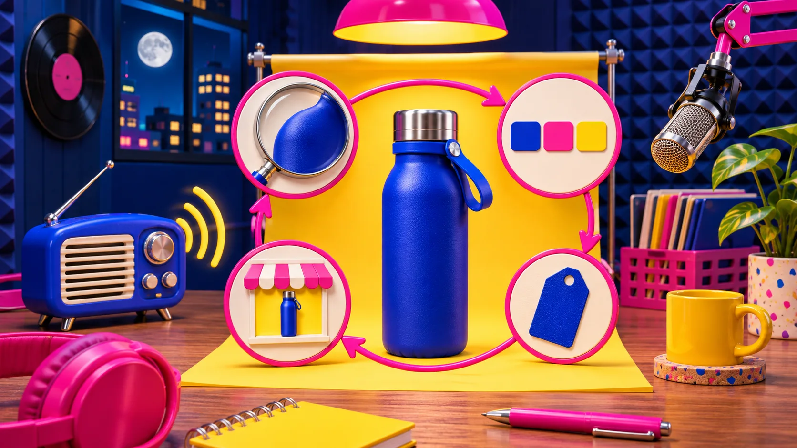

Si necesitas una foto de producto con fondo limpio, no hace falta reinventar el artículo con IA. La forma más segura es recortar el objeto con una máscara, revisar sus bordes a tamaño real y cambiar solo el fondo o la luz que no alteren color, forma, etiqueta ni accesorios. Con [ImageFlow](https://imageflow.dev/) puedes hacer ese trabajo editable en el navegador, sin empezar por una imagen nueva.

El recorte no es un detalle cosmético: es una promesa visual. Un borde que borra parte de un asa, una sombra que hace parecer más grande un envase o una etiqueta suavizada puede crear una expectativa equivocada. Este método sirve para una foto de catálogo, una ficha de Shopify o una creativa de campaña; el objetivo es que el producto siga siendo reconocible y comprobable.

## El método de las cuatro preguntas

Antes de tocar la foto, abre una copia del original y responde estas cuatro preguntas. Evita el impulso de aplicar una eliminación de fondo y exportar de inmediato.

| Pregunta | Si la respuesta es sí | Si la respuesta es no |
| --- | --- | --- |
| ¿El producto se separa claramente del fondo? | Empieza con selección de objeto y una máscara. | Busca primero más contraste o selecciona por zonas. |
| ¿Hay bordes difíciles: pelo, transparencia, metal, cordones? | Reserva una revisión ampliada por borde. | Una revisión general suele bastar. |
| ¿La sombra describe la forma real? | Consérvala o reemplázala por una sombra discreta y coherente. | No inventes una sombra dramática para compensar. |
| ¿El nuevo fondo cambia la percepción del color o tamaño? | Prueba un fondo más neutro antes de publicar. | Mantén la variante elegida y documenta la exportación. |

Este pequeño filtro también ayuda a decidir si la foto merece edición o una nueva toma. Una superficie muy brillante, un objeto transparente o una silueta con muchas hebras pueden requerir más tiempo del que ahorra un recorte rápido. Como regla práctica: si no puedes explicar qué parte del borde es producto y cuál es fondo, todavía no estás listo para exportar.

## 1. Trabaja con una máscara, no con un borrado definitivo

ImageFlow reúne capas, máscaras de capa, grupos, capas de ajuste y selección/eliminación de fondo en el navegador; su página oficial también confirma importación y exportación de PSD. Eso permite empezar con una selección automática y convertirla en una máscara que puedes corregir después, en lugar de destruir píxeles desde el primer minuto.

1. Duplica la capa de la foto original.
2. Haz una selección inicial del objeto y aplícala como máscara a la copia.
3. Añade un fondo provisional de color contrastado debajo. No es el fondo final: sirve para descubrir halos y huecos.
4. Con un pincel suave y pequeño, corrige la máscara solo donde el contraste te permita distinguir el borde.

No uses una herramienta de retoque para rediseñar el producto. Si la botella tiene un arañazo, una costura o un grabado que aparecerá en el artículo enviado, sigue siendo parte de la información visual. Para otro control previo a subir una imagen, te puede servir esta guía sobre [cómo revisar una foto de producto antes de publicarla en Shopify](https://herramientas-y-tutoriales.github.io/2026/11/04/como-revisar-una-foto-de-producto-antes-de-publicarla-en-shopify/).

## 2. Revisa los bordes donde un cliente sí se fijará

Haz zoom al 100 % o más y recorre el perímetro con un orden fijo: parte superior, laterales, base, etiquetas y detalles salientes. Busca cuatro fallos típicos:

- Un halo del fondo anterior, muy visible sobre blanco o negro.
- Un borde mordido que recorta la forma real del producto.
- Un hueco en asas, tiras, vasos transparentes o reflejos metálicos.
- Una etiqueta, logotipo o textura suavizada hasta parecer otra cosa.

La revisión tiene que hacerse sobre al menos dos fondos: uno claro y otro oscuro. Un borde que parece impecable sobre gris puede revelar una línea blanca sobre azul marino. Para una tienda, esta comprobación merece más atención que añadir un efecto atractivo: [Shopify distingue las imágenes como un tipo de media de producto](https://help.shopify.com/en/manual/products/product-media), así que esa imagen acabará describiendo la oferta real.

## 3. Cambia el fondo sin cambiar la promesa del producto

Una vez que la máscara está limpia, elige el fondo por función, no por moda. Blanco o gris suave suele funcionar para catálogo; un color de marca puede funcionar para campañas si el objeto conserva un borde claro; una escena real solo tiene sentido si da contexto útil de escala o uso.

Aquí hay una regla que me gusta porque evita muchas vueltas: **si el fondo explica una situación que el producto no incluye, no lo uses como foto principal**. Por ejemplo, una mesa de desayuno puede ser una imagen secundaria para una taza, pero no debe ocultar que se vende una sola unidad. Del mismo modo, no cambies el color de un artículo para que combine con el fondo.

Si estás preparando imágenes para variantes, separa el problema visual del problema de catálogo. Esta guía sobre [renombrar SKU de Shopify en masa sin romper variantes](https://herramientas-y-tutoriales.github.io/2026/11/18/como-renombrar-sku-de-shopify-en-masa-sin-romper-variantes/) recuerda por qué conviene tratar cada variante como una decisión concreta; su imagen debe corresponder a esa misma variante.

## 4. Ajusta la luz de forma reversible

Las capas de ajuste permiten aclarar sombras, equilibrar temperatura y mejorar contraste sin sobrescribir el original. Haz un ajuste pequeño, compáralo con la capa original y vuelve a mirar colores de referencia: envase, tela, metal, impresión y piel si la foto incluye una persona.

La mejora aceptable aclara la lectura. La mejora engañosa cambia material, tamaño, cantidad o resultado. Si trabajas con una foto generada o una composición, amplía aún más el control: la [ficha de invariantes para revisar fotos IA](https://herramientas-y-tutoriales.github.io/2026/11/12/ficha-de-invariantes-para-revisar-fotos-ia-antes-de-subirlas-a-shopify/) es un buen complemento para comprobar que lo importante no se ha movido.

## 5. Exporta con un recibo breve

Antes de exportar, crea un pequeño recibo de edición. No hace falta software adicional: una nota junto al archivo basta.

- Archivo maestro editable y fecha.
- Foto original de la que partes.
- Fondo elegido y finalidad: catálogo, variante o campaña.
- Dos revisiones de borde: claro y oscuro.
- Formato final y destino de subida.

Esta lista evita que una exportación de campaña acabe como imagen principal de una ficha, o que alguien no encuentre el archivo con capas cuando necesita corregir una etiqueta. Si el producto también va a pasar por una captura 3D, suma una comprobación de preparación física: [esta prueba para saber si un producto está listo para un modelo 3D](https://herramientas-y-tutoriales.github.io/2026/11/20/esta-listo-tu-producto-para-un-modelo-3d-haz-esta-prueba-antes-de-capt/) ayuda a separar un problema de fotografía de uno de captura.

## La prueba final: que el objeto siga siendo el mismo

Abre el original y la exportación lado a lado. Pregunta: ¿reconocería un cliente el mismo color, los mismos bordes, accesorios y proporciones? Si dudas, conserva el original como principal o vuelve a la máscara.

Para probar el flujo, abre [ImageFlow](https://imageflow.dev/) con una sola foto real y haz el cambio más pequeño útil: una máscara y un fondo neutro. Esa práctica muestra rápido dónde están los bordes difíciles, mantiene el documento editable y te deja una imagen más limpia sin prometer un producto distinto.
